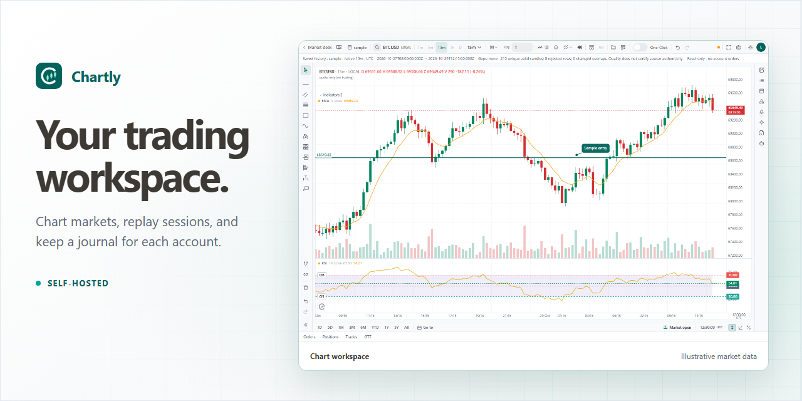
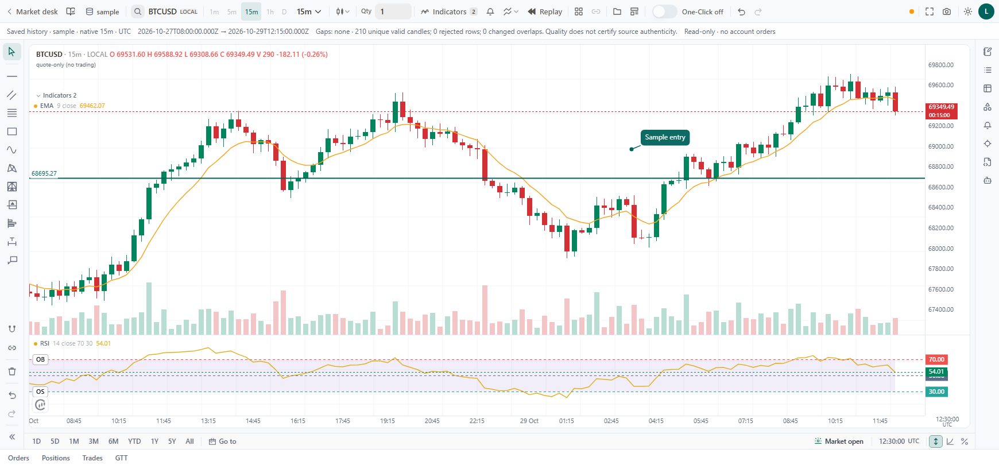
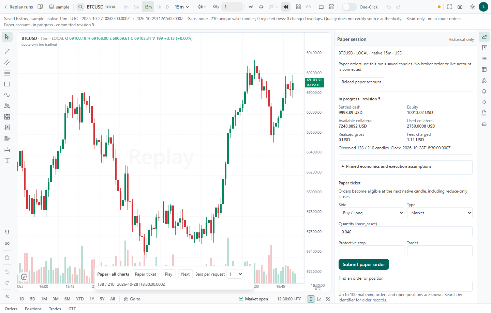
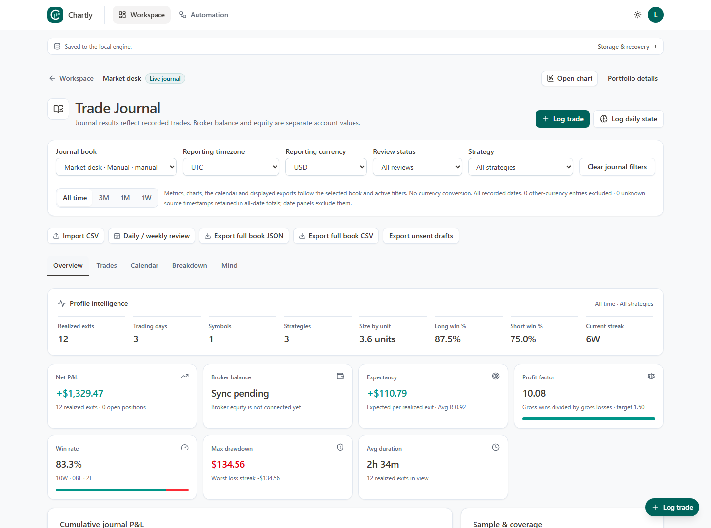

<p align="center">
  
</p>

# Chartly

Chartly is an open-source, self-hosted trading workspace for **market charts, trade journals, paper trading, and manual backtesting**. Bring your own candle history or connect a supported feed. Use chart indicators and drawings to plan a trade, test your rules candle by candle, and review each decision in its account’s journal.

[Screenshots](#screenshots) · [Quick start](#quick-start) · [MetaTrader 5](#metatrader-5) · [Documentation](#documentation) · [Contributing](CONTRIBUTING.md)

## Screenshots

<p>
  <a href="frontend/public/images/product/chartly-landing-chart.png"></a>
  <a href="frontend/public/images/product/chartly-paper.png"></a>
  <a href="frontend/public/images/product/chartly-journal.png"></a>
</p>

[MT5 chart and positions](frontend/public/images/product/chartly-mt5.png) · [Journal trade log](frontend/public/images/product/chartly-journal-trades.png) · [Trading profiles](frontend/public/images/product/chartly-workspace.png)

The screenshots use sample market and account data. Select any image to view it at full size.

## Features

- **Charting and technical analysis.** Open saved candles or a supported feed. Work across multiple panes, switch symbols and intervals, and add indicators, custom studies, drawings, and price levels.
- **Paper trading and manual backtesting.** Replay a saved market session one candle at a time or play forward. Choose starting balance, spread, slippage, and fees. Review simulated orders, fills, positions, and P&L in a report for each run.
- **Trading journals.** Keep a book per account or record trades in a standalone manual book. Import CSV statements, attach chart evidence, and compare selected portfolios in Combined Analysis.
- **Broker connections and data.** Import candle history into the Data Library or use a supported provider. A Windows MetaTrader 5 (MT5) connection can show broker-specific symbols, balances, and positions.
- **Workflows and optional AI assistance.** Build automations from alerts, schedules, or webhooks, and review approvals and execution history. Configure a model provider to use the AI Agent with the tool permissions you grant.

## Quick start

Install Python 3.12 or later, [uv](https://docs.astral.sh/uv/getting-started/installation/), and a Node.js version listed in the [frontend package](frontend/package.json).

```bash
git clone https://github.com/arpanjot-coding/chartly-trading-workspace.git
cd chartly-trading-workspace
test -f .env || cp .sample.env .env
uv sync
cd frontend
npm ci
npm run build
cd ..
uv run app.py
```

<details>
<summary>Windows PowerShell commands</summary>

```powershell
git clone https://github.com/arpanjot-coding/chartly-trading-workspace.git
Set-Location chartly-trading-workspace
if (!(Test-Path .env)) { Copy-Item .sample.env .env }
uv sync
Push-Location frontend
npm ci
npm run build
Pop-Location
uv run app.py
```

</details>

Open Chartly on localhost, choose **Open Workspace**, and follow the setup prompts. [Local Chartly](http://127.0.0.1:5000/) · [Docker build guide](docs/docker/DOCKER_BUILD_GUIDE.md)

1. **Replay a session.** Import a candle CSV into **Data Library**, create a replay project, and start a paper run.
2. **Keep a journal.** Create a profile and open **Journal**. Log a trade manually or import a statement CSV.
3. **Connect an account.** Open **Settings → Connections & Data**, verify the account, then open its profile.

## MetaTrader 5

Run Chartly on the Windows machine with the signed-in MT5 terminal. Verify the connection under **Connections → Desktop platforms** and link it to a live profile. Separate MT5 installations can be linked to separate profiles. [MT5 setup](docs/api/local-connectors.md#metatrader-5)

Quotes, candles, account reads, and order access depend on the provider and account permissions. Demo order submission is disabled by default. [Provider capabilities](services/market_providers.json) · [Release checklist](docs/plans/chartly-professional-platform/CHARTLY_QUALITY_AUDIT.md)

## Documentation

- [User guide](docs/userguide/README.md)
- [Custom chart indicators](docs/custom-indicators.md)
- [Chart study protocol and examples](contracts/chart-study/v1/README.md)
- [Workflow and webhook format](docs/prompt/flow-import-format.md)
- [Agent setup and permissions](docs/design/55-agent/README.md)
- [REST API and Developer API keys](docs/api/README.md)
- [Storage, backups, and draft recovery](docs/plans/chartly-professional-platform/p02/RECOVERY_GUIDE.md)
- [Documentation index](docs/INDEX.md)

### Build the public website

Set `CHARTLY_PUBLIC_SITE_URL` to your public HTTPS origin before running `npm run build` in `frontend`. For Docker, pass the same value as a build argument. The build generates the landing page and guides as HTML, plus canonical URLs, social metadata, and a sitemap. The self-hosted app uses a backend for accounts, data, and workflows.

## Contributing

Run `npm run test:run` and `npm run build` in `frontend`. Run focused Python tests from the repository root using `uv run pytest`. The built app browser test uses sample profiles and candles. [Contributing guide](CONTRIBUTING.md) · [Security policy](SECURITY.md)

## License and upstream

Chartly is derived from [OpenAlgo](https://github.com/marketcalls/openalgo) by Marketcalls and contributors. Chartly is distributed under the [GNU Affero General Public License v3.0](License.md). Dependencies retain their respective licenses.
