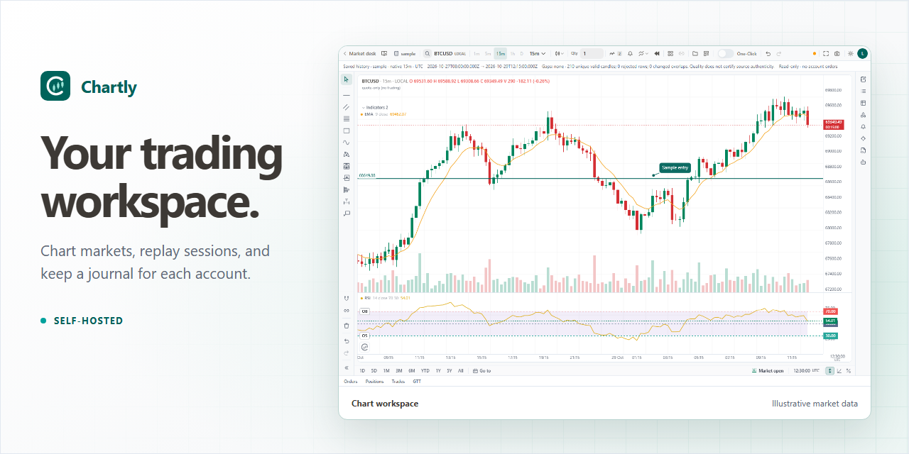
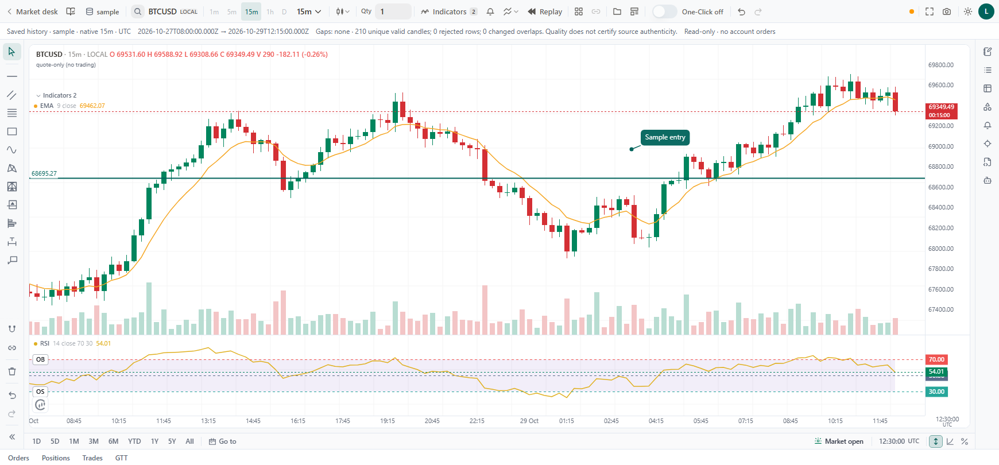
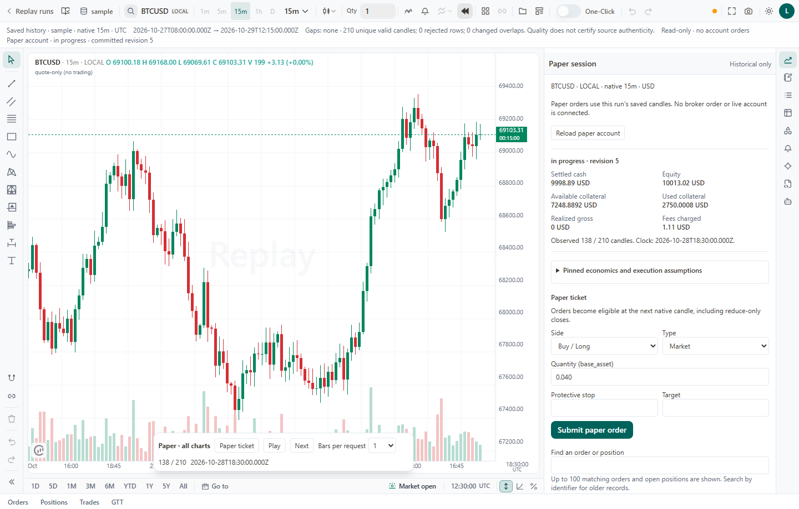
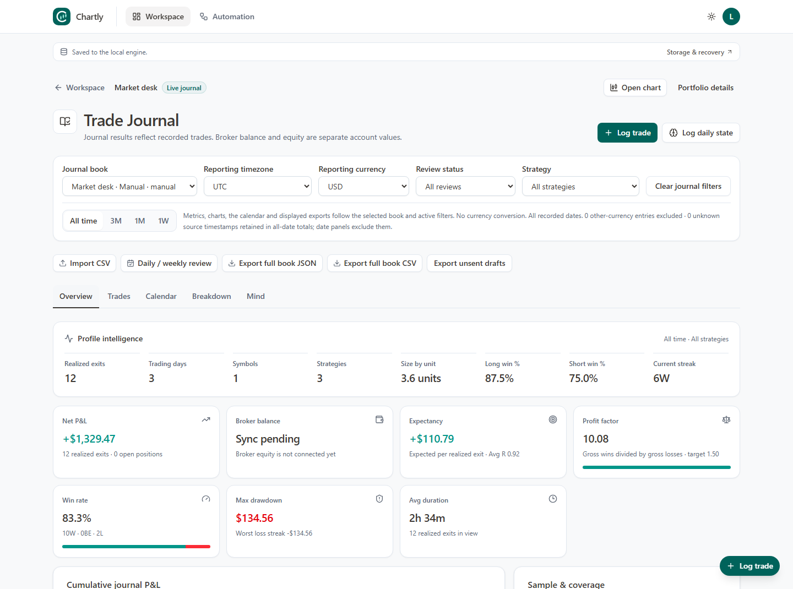

<p align="center">
  <a href="https://chartly-site.vercel.app/">
    
  </a>
</p>

<h1 align="center">Chartly</h1>
<p align="center"><strong>Open-source charting, paper trading, and trade journaling.</strong></p>
<p align="center">
  <a href="https://chartly-site.vercel.app/">Website</a> ·
  <a href="https://chartly-site.vercel.app/demo">Try paper replay</a> ·
  <a href="#quick-start">Install locally</a> ·
  <a href="docs/userguide/README.md">User guide</a>
</p>

Chartly is a self-hosted trading workspace for **technical analysis, manual strategy backtesting, and trade review**. Open saved candles or connect a supported market data source, practise a setup one candle at a time, and review the resulting trades in their own journal book.

The browser demo uses sample BTCUSD candles and simulated orders. Install Chartly for your own historical data, journals, workflows, and MetaTrader 5 connections.

## A look inside

<p align="center">
  <a href="frontend/public/images/product/chartly-landing-chart.png"></a>
  <a href="frontend/public/images/product/chartly-paper.png"></a>
  <a href="frontend/public/images/product/chartly-journal.png"></a>
</p>
<p align="center"><sub>Chartly screens populated with sample data. Select a screenshot to enlarge it.</sub></p>

[MetaTrader 5 chart and positions](frontend/public/images/product/chartly-mt5.png) · [Journal trade log](frontend/public/images/product/chartly-journal-trades.png) · [Trading profiles](frontend/public/images/product/chartly-workspace.png)

## What you can do

- **Build a chart layout.** Switch symbols, timeframes, and data sources. Add indicators such as EMA and RSI, install custom studies, and annotate entries with drawings and price levels. [Chart indicators](https://chartly-site.vercel.app/guides/chart-indicators)
- **Backtest with candle replay.** Practise entries and exits using saved history. Set a starting balance and model spread, slippage, and fees. Finish the run to review simulated fills, open exposure, and P&L. [Manual backtesting guide](https://chartly-site.vercel.app/guides/backtesting-software)
- **Keep a trading journal.** Maintain an account-specific book or a standalone manual book, import trades by CSV, attach chart evidence, and compare selected portfolios in Combined Analysis. [Journal guide](docs/userguide/33-trading-journal/README.md)
- **Bring your market data.** Import and review candle CSVs in the Data Library. Open the saved dataset in a chart or use it to create a replay project. [Data Library guide](docs/userguide/34-data-library/README.md)
- **Connect MetaTrader 5.** View broker symbols, account balances, open positions, and working orders from a signed-in Windows terminal. [MT5 chart guide](https://chartly-site.vercel.app/guides/mt5-charts)
- **Automate a workflow.** Use supported alerts, schedules, and webhooks in Flow. Configure a model provider if you want to use the optional AI Agent with the tool permissions you grant. [Workflow guide](docs/userguide/21-flow-visual-builder/README.md)

## Quick start

Install Python 3.12 or later, [uv](https://docs.astral.sh/uv/getting-started/installation/), and a current [Node.js LTS release](https://nodejs.org/en/download) that satisfies the [frontend version requirements](frontend/package.json).

```sh
git clone https://github.com/arpanjot-coding/chartly-trading-workspace.git
cd chartly-trading-workspace
test -f .env || cp .sample.env .env
uv sync --locked
cd frontend
npm ci
npm run build
cd ..
uv run --no-sync app.py
```

<details>
<summary>Windows PowerShell</summary>

```powershell
git clone https://github.com/arpanjot-coding/chartly-trading-workspace.git
Set-Location chartly-trading-workspace
if (!(Test-Path .env)) { Copy-Item .sample.env .env }
uv sync --locked
Push-Location frontend
npm ci
npm run build
Pop-Location
uv run --no-sync app.py
```

</details>

Open [local setup](http://127.0.0.1:5000/setup) to create your account, then [sign in](http://127.0.0.1:5000/login) to use Workspace. Chartly generates per-install security keys on first run. A broker account is optional for local journals and CSV-based replay. [Installation guide](docs/userguide/04-installation/README.md) · [Docker build guide](docs/docker/DOCKER_BUILD_GUIDE.md)

### Run your first replay

1. In **Data Library**, import a candle CSV and review its time zone, interval, and coverage.
2. In **Workspace → New profile**, choose **Replay project** and select the saved history.
3. Open the project’s **Chart**, select **Paper session**, and review the starting balance and fill assumptions.
4. Step through candles, place simulated orders, and finish the run. Open the saved report or the run’s journal to review your decisions.

See [historical paper sessions](docs/userguide/35-paper-sessions/README.md) for fill rules, checkpoint recovery, and reports.

## MetaTrader 5

1. On the Windows machine that runs Chartly, install the optional connector with `uv pip install -r requirements-mt5.txt`.
2. Open MetaTrader 5 and sign in. In Chartly, open **Settings → Connections & Data → Desktop platforms**, verify the terminal, and link the observed account to a live profile.
3. Open that profile’s chart. Search using the broker’s actual symbol, including any prefix or suffix.

To connect several MT5 accounts, use a separate signed-in terminal installation for each profile. Available data and order access depend on the provider and account permissions. [Multiple-terminal setup](docs/api/local-connectors.md#metatrader-5) · [Provider capabilities](services/market_providers.json)

## Documentation

- [User guide](docs/userguide/README.md) and [troubleshooting](docs/userguide/29-troubleshooting/README.md)
- [Custom indicators](docs/custom-indicators.md) and [chart study protocol](contracts/chart-study/v1/README.md)
- [Developer API](docs/api/README.md), [workflow webhooks](docs/prompt/flow-import-format.md), and [AI Agent permissions](docs/design/55-agent/README.md)
- [Storage, backups, and recovery](docs/plans/chartly-professional-platform/p02/RECOVERY_GUIDE.md)
- [Project architecture](ARCHITECTURE.md) and [documentation index](docs/INDEX.md)

For a public landing page build of this checkout, set `CHARTLY_PUBLIC_SITE_URL` to your public HTTPS origin before running `npm run build` in `frontend`. The build generates the landing page and guides as HTML alongside canonical links and a sitemap.

## Contributing

See the [contributing guide](CONTRIBUTING.md) for local verification and pull requests. Run `npm run test:run` and `npm run build` from `frontend`. Run the relevant backend tests with `uv run pytest` from the repository root. Follow the [security policy](SECURITY.md) for private vulnerability reports. [GitHub Actions](https://github.com/arpanjot-coding/chartly-trading-workspace/actions/workflows/ci.yml)

## License and credits

Chartly is distributed under the [GNU Affero General Public License v3.0](License.md). It is derived from [OpenAlgo](https://github.com/marketcalls/openalgo) by Marketcalls and contributors. Dependencies retain their respective licenses.
