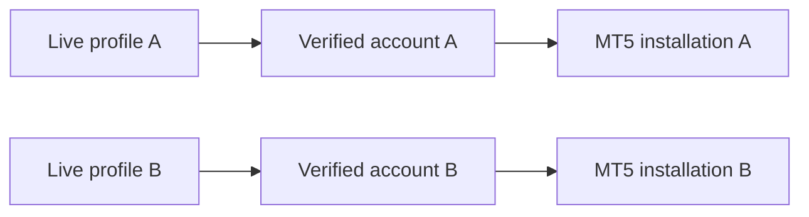

# Local connector API — P07 read-only foundation

The private base is `/api/local/v1/connectors`. Requests use the existing local-account proof cookie and CSRF token. Responses are private/no-store and nosniff. Unknown queries/fields, duplicate JSON keys, nonfinite numbers and oversized bodies are rejected. Maximum request body is 64 KiB. This API has no trading, cancellation, copying or bot-arming action.

`GET /providers` returns static allowlisted provider descriptions and prerequisites. SDK availability, configured labels, observed account identity, current health and certification are distinct. `GET ?originId=…&profileId=…` lists owned connections; profile is optional. `GET /<connectionId>?originId=…` returns the selected public snapshot. `GET /<connectionId>/history?originId=…&offset=0&limit=100` returns at most 200 immutable observations with compact connection metadata, actual coverage and conflicts. There is no plaintext credential read endpoint.

`POST /action` accepts `{originId,connectionId?,expectedRevision,requestId,action,payload}`. A create omits connectionId and starts at revision zero. Other commands require the exact owned connection ID and its current revision. Request IDs are stable, bounded identifiers. Successful mutation replies contain `{connection,workspace,receipt}`, including a recovered duplicate request. The workspace is read after the transaction closes; a lost response cannot leave journal projection unpublished to the client. A repeated ID/body returns its receipt; a changed body with the same ID is rejected.

Actions and payloads:

- `create`: `{providerId,label,configuration,profileId?}`. This saves unverified intent only. The server normalizes static provider configuration. No arbitrary URL, module or executable is accepted.
- `probe`: `{}`. Reads actual account identity, granted read capabilities, observation time and safe diagnostics. A changed observed account is an error; a typed label does not relink it.
- `link`: `{profileId,accountId?,createObservedAccount?,confirmIdentity:true}`. Requires a fresh matching observation and explicit review. Existing account platform/server/login/environment/currency must match. Ambiguous saved matches require explicit account selection. Binding retains existing numeric account/book IDs and review history. New observed accounts start disabled for legacy trading.
- `configure`: `{label?,configuration?}`. Resets measured availability/certification and requires another check. It cannot set health, readiness, observed identity or permission.
- `sync`: `{window:{from,to}}`. Explicit UTC window, at most seven days, fetched outside the SQL transaction. Identity/configuration/credential generation/revision are rechecked before publication. Bounded native cursors resume the same request window; actual page coverage can be a smaller subwindow.
- `apply-corrections`: `{}`. Applies exactly the retained financial-change preview at the reviewed revision; no new source fetch occurs. Ordinary sync retains provider corrections and shows changed fields while preserving old journal facts pending review.
- `set-secret`: `{secret:{apiKey?,apiSecret?,accessToken?,refreshToken?,password?},expiresAt?}`. A small direct authenticated operation encrypts immediately, without serializing plaintext to worker request files. Values are bounded; only opaque metadata returns. Replacement increments generation and requires revalidation.
- `disconnect`, `revoke`, `archive`: `{}`. Retain history/book relations. Revocation/archive remove usable credential material and active linkage. There is no purge or blind resubmission.
- `conformance`: `{}`. The trusted adapter runner performs observed read-only checks. Callers cannot submit passing evidence or choose a readiness level. Synthetic results cannot certify a real provider.

Health becomes stale after 120 seconds without a current observation. Fresh partial raw-history coverage may be degraded while its observed account remains valid. Wrong identity, stale whole responses, expired/revoked credentials and restored metadata cannot grant effective capabilities. The next-step planner suggests a maximum seven-day window with five-minute overlap from verified coverage; an unfinished native cursor retains its exact window. Unknown source-clock coverage never invents a high-water mark. A suggestion is reviewed explicitly; P07 starts no automatic background scanner.

The encrypted local vault uses Fernet with a domain-separated key derived from the installation's protected application key and principal scope. Authenticated encrypted payloads bind origin/connection/generation/expiry. No fallback key or global broker credential is used. Secret-bearing request receipts use a keyed digest. Key loss, corruption and expiry fail closed. Workspace backups/Undo exclude credentials and clear usable vault records; restored connector history is retained with inactive linkage and required verification.

## MetaTrader 5

Current providers include a clearly synthetic diagnostic adapter, explicitly selected running Windows MT5 terminals, public Kraken reachability, and documented brokerage prerequisites. Shared native terminal attachment requires the verified local operator. The optional SDK is pinned in [requirements-mt5.txt](../../requirements-mt5.txt). MT5 reads use the existing login and close only the Python attachment. Actual testing found unverified provider-clock alignment, so native market timing and broad MT5 deal-to-journal accounting remain unsupported; raw deals retain their own time basis and incomplete coverage. A balance/partial-fill/unknown-submission observation never becomes an invented closed trade.

To connect more than one MT5 account, run a signed-in terminal from a separate Windows installation directory for each account. Set `CHARTLY_MT5_TERMINAL_PATHS` to a semicolon-separated list of approved additional `terminal64.exe` paths and restart Chartly. In **Connections → Desktop platforms → MetaTrader 5**, enter the approved path for each connection, verify its account, and link it to a separate live profile. An empty field selects the standard MetaTrader 5 installation. Chartly serializes native IPC within each process and checks the selected installation and verified login before using profile-bound market data and account books. Each live profile has one active MT5 account.

Profile charts use their verified connection for candles, symbol search, watchlist quotes, and account books. If the linked connection changes while its chart is open, reopen that profile’s chart to load the current account.

Records are bounded to 4 MiB per connection, 32 MiB per origin, 100 connections, 5,000 observations and 200 events per page. Full ledgers are excluded from routine workspace JSON. [Ordered P07 plan](../plans/chartly-professional-platform/p07/IMPLEMENTATION_PLAN.md), [history/recovery details](../plans/chartly-professional-platform/p07/HISTORY_STORAGE_RECOVERY.md), [provider plans and certification](../plans/chartly-professional-platform/p07/adapters/README.md).
