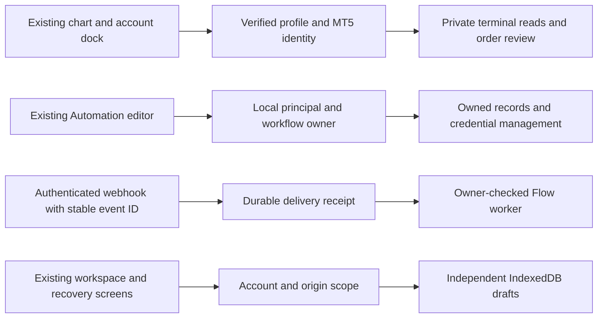
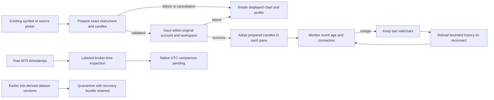

# Chartly product and engineering quality audit

9 November 2026 · Windows local development build · Chart, journal, replay, connections, Automation, and release engineering

Chartly has a working chart and local trading workspace worth preserving. The fastest route to an excellent charting app is to make four things dependable in every pane: the exact instrument, where its prices came from, how current the data is, and which account the user is looking at. The audit found defects in those boundaries and in Automation. Resolve them before broadening provider support or enabling general execution.

This is an audit and delivery plan. **Observed** means seen in the running app or recorded native verification. **Reproduced** means a controlled fixture or command demonstrated the behavior. **Source review** identifies a concrete code path whose full integration effect still needs testing. **Open** means acceptance evidence is missing. Earlier package completion applies to the scope and evidence of that package. No additional package was marked complete by this review. [Prior chart verification](p05/TRADING_IDE_REVIEW.md).

## The workflow a trader should have

1. **Open Workspace.** A profile is an environment. The existing Chart and Journal buttons open the two work surfaces. Open leads to Overview, Connections, and Settings. Combined Analysis compares only selected profiles in the selected currency and keeps its existing clear and save controls. Keep one active connected book for each verified account and separate manual books.
2. **Choose a starting point.** New profile offers live and replay. Live users can begin with public prices, saved history, or a supported account connection. Replay users choose real saved history first and confirm the currency, capital, costs, instrument, and date range for the run. Give both flows a summary of what will work immediately and a direct way to complete the missing step.
3. **Connect once.** One connection flow handles MT5 on this PC, an API token, an official broker sign-in, a local gateway, or manual import. After the handshake, show the observed account and environment, choose its journal, and optionally choose a market feed. Expose the same saved connection and status from Settings and the profile. Show why a capability is unavailable, which side must change, and when it was last checked. A stale saved verification and a currently responding terminal are separate facts and need distinct labels.
4. **Chart first.** Keep the existing chart, studies, watchlist, layouts, drawing tools, and shortcuts. The header should show the current instrument, source, timeframe, and a clear freshness state. The dock independently shows the selected account with its environment. Each pane resolves exact native names, supports keyboard search, and keeps the last valid series visible when a change fails, with the displayed series and requested series clearly named. The user can use a source in this view or explicitly set it as the profile default.
5. **Review trading data and replay.** Display positions, working orders, historical orders, fills, and cash/fee events as distinct kinds of records. Give every table a coverage range, last successful read, and one clear retry action. From a fill or journal entry, open the recorded instrument and timeframe using the applicable saved version. Label current-price analysis explicitly when historical evidence is missing. Replay opens its pinned version and paper account without switching a live account or sending a real order.
6. **Automate after the manual workflow is proven.** Choose a verified account and permissions for each workflow. Default the first run to a preview or simulation, expose what it will read and what it can send, and make pause, last outcome, and reconciliation obvious. Fundamentals, Strategy Builder, and strategy testing remain outside the active release. Keep manual replay, chart studies, and the journal central.

Observed in the browser during this audit: Workspace exposes New profile, Combined Analysis, Chart, Journal, and Open. The live creation form labels session tags optional. Combined Analysis shows reporting currency, Clear all and Save selection. Profile management has its own tabs. The journal shows its book and an Open chart link that returns to the same journal. The running chart displayed EURUSD candles and the MT5 dock. Connections showed an older stale verification for that profile, with Verify account and bounded history actions. Automation opened its workflow list. No account settings, journal data, or trades were changed during the walkthrough.

## Findings that determine release readiness

### A1. MT5 can silently move valid candles to the wrong time

**Critical for replay, evidence, or execution. Reproduced.** The adapter estimates the clock offset by rounding a tick-to-wall-clock difference to a whole hour. A fixture with a valid UTC candle and a three-hour-old reference tick passed as a three-hour clock offset. Chart conversion and the saved import path both accept that estimate and move the candle forward. A closed session can also hide cached bars when the estimate cannot be made. The implementation currently applies one present-day estimate to all returned rows, which cannot establish past DST alignment. [MT5 clock inference](../../../services/connector_mt5.py#L401) · [Chart conversion](../../../frontend/src/lib/chart/feeds/platformFeed.ts#L115) · [Saved feed import](../../../services/feed_market.py) · [MetaQuotes date-range API](https://www.mql5.com/en/docs/python_metatrader5/mt5copyratesrange_py).

Store raw time, observed time, provenance, and the verified transformation separately. Compare the documented UTC behavior with native evidence per terminal, server, and interval. Use the documented basis where verified. Where the basis is unresolved, make the native series inspectable in a labeled read-only broker-time view. Keep it out of time-sensitive imports, replay, journal accounting, and order actions until verified. Quarantine affected derived dataset versions pending review and preserve their original source and checksums. The acceptance fixture must reproduce the exact whole-hour stale-tick case, weekends, half-hour sessions, DST transitions, and H4/D1 session boundaries without false UTC timestamps.

### A2. An MT5 chart profile and the signed-in terminal account can diverge

**Critical before account-bound actions. Source review and fixture evidence.** The chart dock requests MT5 account data with a Chartly principal and provider. It does not send an expected verified connection identity. The backend reads whichever MT5 account is signed in. The demo preview signs the observed account and catches later identity changes, but the first preview can already refer to another account than the profile suggests. A fixture confirmed that a remote named principal could invoke native MT5 symbol, candle, and quote paths while the account route refused it. [Market route boundaries](../../../blueprints/market_data.py#L76) · [Account dock](../../../frontend/src/components/trading/dock/AccountFeedDock.tsx) · [Native account snapshot](../../../services/connector_mt5.py#L553) · [MT5 order review](../../../services/mt5_execution.py#L138).

Make the verified connection ID and observed account identity part of every private account request and command. Clear old rows immediately on mismatch, offer Reverify or Switch account, and never silently relink a journal. Display price source and account as separate labeled choices. Apply one explicit native terminal access policy to account, symbol, quote, history, and saved-import paths. Keep public feeds under their own policy. Test two installed terminals and two accounts, a switch during a read and during preview, a remote named session, and requests proxied with forged loopback headers.

### A3. Flow ownership and outbound network controls need release gates

**Critical for mixed principals or exposed Automation. Reproduced in isolated Flask and network fixtures.** A personal principal retrieved a pre-existing installation-wide workflow's webhook credentials. A synthetic webhook reached the dispatch stub using that workflow's stored key. The legacy workflow schema has no owner. Separately, the Flow HTTP executor validated a public DNS response, then HTTPX resolved the same hostname again and attempted a loopback connection. The fixture intercepted the attempt before network I/O. A caller-controlled destination can therefore defeat the current public-address check. [Flow detail and credentials](../../../blueprints/flow.py#L155) · [Workflow schema](../../../database/flow_db.py#L80) · [Outbound HTTP](../../../services/flow_executor_service.py#L3177) · [OWASP object authorization](https://api-security.owasp.org/editions/2023/en/0xa1-broken-object-level-authorization/) · [OWASP SSRF prevention](https://cheatsheetseries.owasp.org/cheatsheets/Server_Side_Request_Forgery_Prevention_Cheat_Sheet.html).

Scope workflows, executions, schedules, stored keys, and reads to an owner or explicit grant. Design a reviewed adoption path for legacy workflows. Replace secret retrieval on ordinary detail reads with a dedicated reveal or rotation flow. Enforce destination policy on the connection itself, use allowlisted hosts or validated-IP transport with TLS hostname verification, disable inherited proxies for that client, and bound redirects, decoded bytes, and total time. Require two-principal negative tests and a controlled DNS-rebinding test across IPv4, IPv6, redirects, and proxy settings. Keep exposure and new privilege grants gated while those controls are incomplete.

### A4. Repeated delivery can still create another execution

**High. Reproduced with dispatch stubs and a simulated MT5 SDK.** Two sequential authenticated Flow deliveries with the same event ID received different run IDs. The in-flight lock cannot catch delivery after completion. A non-string secret caused a 500 in the fixture. The MT5 ticket correctly protects duplicate submission of the *same* review ID and recovers its stored receipt after reload. A new review ID still dispatched while the first outcome was unresolved, and a stale fixture tick passed preview and submission. The native request addresses the running session and has no account field. [Webhook ingress](../../../blueprints/flow.py#L1115) · [MT5 request and receipt](../../../services/mt5_execution.py#L86) · [Browser receipt recovery](../../../frontend/src/components/trading/Mt5OrderTicket.tsx) · [MetaQuotes request fields](https://www.mql5.com/en/docs/python_metatrader5/mt5ordersend_py).

Claim a durable workflow delivery key before execution and return the original outcome for a matching retry. Reject conflicting bodies under the same event identity. Validate signed ingress shape and bound replay windows. For orders, reserve the account-bound intent before dispatch and recover it across browsers and restarts. Uncertain results require reconciliation by provider IDs and order comment, or an explicit operator decision after checking the terminal. Verify quote age, side, spread, and session independently of chart bars. Use one shared intent and receipt lifecycle for manual and automated commands. Keep the MT5 demo send switch disabled by default until a dedicated terminal proves account fencing, reconnect, and reconciliation. No native order was sent during this audit.

### A5. The chart can say live while it shows old bars

**High. Source review.** A direct source announces a live state before the first read. The pane derives its status color from that label. Later polling updates chart data but does not drive a separate freshness state. The order ticket currently gates on load and replay state, which cannot establish quote freshness. [Pane status mapping](../../../frontend/src/components/trading/ChartPane.tsx#L175) · [Direct feed initialization](../../../frontend/src/lib/trading/terminal.ts#L7717) · [Ticket gate](../../../frontend/src/pages/Trading.tsx#L2090).

Introduce states for loading, current, delayed, market closed, reconnecting, and unavailable. Derive them from provider event time, response time, trading calendar, and entitlement. Keep last good bars available and label the last successful update. On reconnect, repair the gap before resuming. Test a silent stream, timeouts, closed sessions, missing entitlements, and a symbol switch during reconnect. A green label must correspond to recent valid data for the displayed series.

### A6. A source switch can save a profile and strand the chart

**High. Reproduced with the actual selection callback and resolver in an isolated fixture.** The test opened a GBPUSD/MT5 link and selected ETHUSD/Kraken. The callback saved Kraken as the profile source while retaining GBPUSD/MT5 in navigation, and the resolver rejected the mismatched venue. Changing to saved history shares the navigation code and needs its own end-to-end case. The source picker also hides direct live sources while a saved dataset is active. [Resolved navigation](../../../frontend/src/lib/trading/chartContext.ts#L546) · [Source change](../../../frontend/src/pages/Trading.tsx#L2010) · [Picker condition](../../../frontend/src/components/trading/ChartContextControls.tsx#L156).

Treat a feed change as a pending transition. Resolve and load the new instrument before publishing it. Rebuild the query from the new context and keep the original chart and profile settings on failure. Test live to saved and back, two providers on the same ticker, switching rapidly, shared chart links, and journal return. Use existing cancellation and two-phase workspace loading patterns.

### A7. Full MT5 trading data is possible, and the current integration covers a subset

**High for journal reliability. Native evidence plus source review.** Chartly currently reads the native catalog, recent quotes and candles, account details, positions, pending orders, and bounded raw deals. The earlier live run loaded EURUSD and GBPUSD candles, fetched XAUUSD and AAPL from the adapter, and confirmed the empty positions and working orders matched the terminal. The dock loaded deal history. Filled, canceled, and expired historical orders are separate from deals. The current MT5 path does not call the historical orders API, does not claim complete coverage or canonical journal facts, and does not run automatic startup sync. Some related order/position IDs cross JSON as numbers and can lose precision in JavaScript. [MT5 adapter](../../../services/connector_mt5.py#L148) · [Browser data contract](../../../frontend/src/api/marketData.ts#L45) · [Journal sync state](../../../frontend/src/pages/workspace/TraderJournal.tsx#L2977) · [MetaQuotes order history](https://www.mql5.com/en/docs/python_metatrader5/mt5historyordersget_py) · [MetaQuotes deal history](https://www.mql5.com/en/docs/python_metatrader5/mt5historydealsget_py).

Add the account ledger described below. A successful bounded poll means the service responded. It does not establish coverage before the requested range or for records the broker or terminal has not made available. Verify coverage independently and display missing ranges.

### A8. Studies and local code need an explicit trust boundary

**High before sharing extensions. Source review.** JavaScript study preview and saved modules execute in the browser origin before descriptor validation. The saved URL uses a modification timestamp truncated to seconds and can serve current content under an older URL marked immutable. The legacy Python strategy runner inherits the server environment and project working directory. These are operator-trusted code paths today. [Study preview](../../../frontend/src/lib/trading/validateCustomIndicator.ts#L69) · [Browser module load](../../../frontend/src/lib/trading/customIndicators.ts#L327) · [Study cache policy](../../../blueprints/custom_indicators.py#L65) · [Python launch](../../../blueprints/python_strategy.py#L866).

Version studies by content hash and pin the version in layouts and chart evidence. Keep inputs and outputs declarative. Before opening an extension ecosystem, isolate the runtime from the app origin and filesystem, remove ambient credentials and network access, cap CPU, memory, and output, and require explicit capabilities. Keep trade authority outside study evaluation. Confirm a study can neither fetch private endpoints nor use app cookies, and a failed or stalled study cannot freeze chart interaction.

### A9. Data volume creates a bottleneck in everyday actions

**High at normal multi-pane and account workloads. Reproduced and source review.** The live chart polls every five seconds and fetches up to 1,000 bars even when the refresh needs only a few. The adapter coalesces requests only when the `AbortSignal` also matches and reports no older page. The watchlist can fan out one quote call per symbol and abort the preceding cycle before all responses publish. MT5 serializes native attachments, so watchlist, panes, and the dock compete. A fixture with 201 deals returned a history error even when the UI requested one row. [Recent feed cache and paging](../../../frontend/src/lib/chart/feeds/platformFeed.ts#L165) · [Watchlist quote loop](../../../frontend/src/components/trading/useFeedQuotes.ts#L31) · [MT5 read cap](../../../services/connector_mt5.py#L134) · [Chart poll settings](../../../frontend/src/lib/trading/terminal.ts#L7737).

Use one shared subscription or polling worker per account and market source, with separate subscriber cancellation and a bounded provider queue. Batch quotes, fetch only the tail on steady state, backfill a bounded gap on reconnect, and fetch older pages with cursors. Prefer provider streams where supported. Apply viewport-aware rendering and pause or slow offscreen work. A 50-symbol watchlist should retain partial successful results, with per-symbol freshness and a terminal queue that leaves headroom for the dock. Display recent deals from a bounded account event cache. Adaptively split dense backfill windows or use a verified provider cursor. Surface precise coverage and a continuation instead of dropping the whole history panel.

**Workspace reads are a separate cost.** The ordinary workspace route reads every compatibility table and materializes journal ledger data. Chart context then filters and sorts the collection in the browser. In a local SQLite fixture, seven reads plus JSON serialization at each size produced the following median results. At 100 trades, 23,023 bytes and 3.5 ms. At 1,000 trades, 215,624 bytes and 8.4 ms. At 10,000 trades, 2,150,625 bytes and 57.3 ms. These are synthetic payloads with short notes and exclude network transfer, browser parsing, attachment bytes, and UI rendering. Keep full snapshots for migration, export, and recovery. Use compact chart context, paged trade reads, and narrowly scoped edits for the normal workflow. Keep server revision and idempotency checks across tabs. [Workspace reader](../../../services/workspace_storage.py#L420) · [Workspace response](../../../services/workspace_storage.py#L572) · [Trader data hook](../../../frontend/src/lib/trader/useTraderData.ts#L90).

### A10. Selected-pane replay can depend on unrelated panes

**Medium. Existing test and source review.** The controller prepares every pane even when the scope is the focused chart. A sibling without enough candles can roll back the focused replay. The existing rollback test validates the atomic behavior. Keep that behavior for all-pane mode and prepare only members of the selected scope. Test a ready pane beside a failed feed, cancellation during preparation, a source or layout change mid-run, and a successful stop with no retained replay layer. [Replay scope](../../../frontend/src/lib/trading/workspaceReplay.ts#L68) · [Preparation](../../../frontend/src/lib/trading/workspaceReplay.ts#L227) · [Rollback test](../../../frontend/src/lib/trading/workspaceReplay.test.ts#L274).

### A11. Setup, chart, and Data Library describe different providers

**Medium. Source review and browser walkthrough.** New profile, chart source selection, and Data Library maintain different provider lists. For example, the chart offers Kraken and Hyperliquid while New profile omits them. The generic interval directory advertises MT5 daily while the direct chart and saved importer omit it. New profile's data test can succeed on a nonempty candle response that the chart rejects during conversion. The desktop adapter only accepts one default Windows install path. The presence of the Python SDK alone cannot establish terminal readiness. [New profile list and data check](../../../frontend/src/pages/workspace/TraderWorkspace.tsx#L111) · [Chart source list](../../../frontend/src/components/trading/ChartContextControls.tsx#L24) · [Data Library list](../../../frontend/src/pages/historify/DataLibraryFeedSource.tsx#L10) · [Provider directory](../../../services/market_feeds.py#L875) · [MT5 install check](../../../services/connector_mt5.py#L34).

Build all pickers from one capability manifest that separates directory entries, implemented adapters, configured connections, and verified capabilities. Use the real chart adapter to verify the chosen symbol, time and interval. For MT5, discover running approved local installations, show a masked server/account and terminal build, require an operator choice if several match, and reject arbitrary paths or browsers supplying executable names. A terminal can stop between the precheck and MetaQuotes initialization. The SDK may launch a terminal if needed, so certify a design that enforces the desired attach-only behavior under that race. [MetaQuotes initialize](https://www.mql5.com/en/docs/python_metatrader5/mt5initialize_py).

### A12. Passing unit tests does not currently gate the whole release

**High for shipping confidence. Reproduced and CI review.** The previous verification passed the full frontend unit suite and the focused backend suite. The full backend run hit seven collection errors for removed or missing modules, and continuing hit a Windows sandbox proxy timeout. The Linux gthread CI glob includes a test importing retired OI code. The browser navbar expectation still names retired primary navigation, and browser CI starts Vite rather than a seeded Flask instance with its real API. The required job lists omit MT5 execution, account snapshot, market data, and retired route coverage. Built artifact and Docker publishing paths do not both require a passing end-to-end gate on the exact app under test. [CI](../../../.github/workflows/ci.yml) · [Browser configuration](../../../frontend/playwright.config.ts) · [Stale navigation test](../../../frontend/e2e/navbar-fit.spec.ts#L72) · [Legacy OI collection import](../../../test/test_gthread_rest_oi_profile_deadline.py#L33).

Classify each failing test as active, intentionally retired, missing source, or environment-specific. Update the active expectation or recover its required implementation, and explicitly retire incompatible tests alongside their feature. Preserve legacy-data migration and retired-route tests. Gate packaging on fresh checkout, deterministic test databases, Windows native adapter fixtures, Linux runtime tests, and browser journeys against Flask plus the same built frontend users receive. Report passed, skipped with reason, and unverified separately. Include supported runtimes, dependency lockfiles, vulnerability scanning, and an upgrade and restore drill on copies of existing data.

### A13. Two-tab writes and account changes can break local recovery

**High. Source review with concrete interleavings.** The server protects a saved workspace with a revision check and request receipts. The browser uses one pending key per principal and origin, plus an in-memory write queue per tab. Two tabs can both read an empty pending slot and write different requests. If the server accepts A and rejects B, A's unconditional cleanup can delete B's retained draft. A separate account-change path checks the session epoch before awaited IndexedDB work. An old load can resume after sign-out or account switch and publish the previous binding and unscoped runtime preferences. Combined Analysis also initially reads its selection from a global localStorage key before verified account and origin hydration. [Workspace load and draft writes](../../../frontend/src/lib/trader/dataPersistence.ts#L156) · [Runtime preference restore](../../../frontend/src/lib/trader/browserSnapshot.ts#L263) · [Combined selection](../../../frontend/src/lib/trader/combinedSelection.ts#L11) · [Server revision check](../../../services/workspace_storage.py#L1142).

Store pending drafts by request ID and perform transactional conditional cleanup. Apply the account and origin generation fence after awaited work and at the point of publication. Scope local preferences and Combined Analysis selection to that same identity. Force a two-tab conflict and recover the losing draft after reload. Delay an old account response during IndexedDB work, switch accounts with overlapping numeric IDs, release the delayed response, and assert the current view, preferences, and durable data still belong to the new account. Retain existing transactional paper state, immutable dataset windows, and additive recovery. [Paper verification](p06/IMPLEMENTATION_EVIDENCE.md) · [Storage recovery design](p02/ARCHITECTURE.md).

## MT5 account and universal adapter design

**What exists.** MT5 uses the local Python terminal API. The chart has separate public adapters for Binance, Bybit, Coinbase, OKX, Bitget, Kraken, and Hyperliquid. Dukascopy covers a historical FX data path. OANDA has a separately configured market reader. The connection layer has bounded read adapters and fixtures for several crypto venues and selected services, including Alpaca Paper and TopstepX. Registry presence, public bars, authenticated reads, and order capability are different evidence levels. IBKR, cTrader, NinjaTrader, MT4 and other directory entries need their own implemented and verified route before a Connect action can promise account access. The previous verification fetched public Kraken and Hyperliquid candles. A private-account certification is still per provider, environment, entitlement, and product. [Market adapters](../../../services/market_feeds.py) · [Connection adapters](../../../services/connector_adapters.py) · [Prior native evidence](p05/TRADING_IDE_REVIEW.md#verification-on-9-november).

**Account ledger for MT5.** Build an owner- and account-bound read pipeline. Snapshot account details, current positions, and working orders, then page historical orders and deals independently. Preserve native order, deal, and position identifiers as strings end to end. Store event kind, raw timestamp, verified UTC if available, source, currency, exact amount or quantity, and import/coverage metadata. Keep opening, closing, partial fills, netting reversals, hedged positions, order changes, canceled and expired orders, commissions, swaps, fees, and cash transfers distinct. Turn confirmed events into journal facts through a tested projection. Keep broker equity separate from journal P&L and preserve the reason for unmatched records. [MetaQuotes order, deal, and position concepts](https://www.mql5.com/en/docs/trading).

**Backfill and refresh.** A connection owns separate checkpoints for orders and deals. Reattach only to the verified account, read overlapping windows, deduplicate by stable provider identity, retain corrections, and commit observations and their checkpoints in one transaction. Recompute the journal projection from accepted facts. On reconnect and on app open, resume the enabled sync, keep visible last successful timestamps, and never mark incomplete intervals complete. Use an on-demand first backfill with preview, then incremental refresh while the desktop app is open. A terminal event bridge could speed up updates later. MetaQuotes documents that `OnTradeTransaction` events can arrive out of order and the queue is bounded, so a bridge still needs snapshot reconciliation and gap repair. [MetaQuotes transaction events](https://www.mql5.com/en/docs/event_handlers/ontradetransaction).

**Three contracts.** A market adapter resolves instrument definitions and serves candles, quotes, history, or streams. An account adapter lists accounts and reads positions, orders, executions, and ledger coverage. An execution adapter accepts account-bound commands with capabilities, native acknowledgments, and reconciliation. A manifest can implement any subset. Each instrument needs an internal ID, exact native symbol per provider, venue, product kind, settlement/quote currency, increments, multiplier, calendar, and contract terms where applicable. Futures, continuous series, spot, CFDs, options, and perpetuals can share a display ticker. Execution must resolve the exact deliverable instrument and quantity rules. [Databento definitions](https://databento.com/docs/schemas/instrument-definitions) · [TradingView subscriptions](https://www.tradingview.com/charting-library-docs/latest/connecting_data/datafeed-api/datafeed-subscriptions/).

**Connection families.** First certify MT5 as the local terminal family. Certify one public crypto feed and an authenticated exchange account separately. Add a brokerage account with distinct authentication and recovery semantics, such as IBKR through a supported gateway or a supported paper adapter. Kraken's private executions stream can include snapshots and account events, while IBKR execution history is constrained by its gateway and settings. Design coverage to state those limits rather than promise a universal history depth. Use official broker OAuth with state and PKCE where applicable, scoped API keys with verification, a signed local bridge for approved desktops, or statement import when a direct integration is unavailable. User secrets belong in the local vault or key store, away from studies, logs, and browser storage. [Kraken executions](https://docs.kraken.com/exchange/api-reference/spot-websocket-v2/executions) · [IBKR execution history](https://www.interactivebrokers.com/docs/tws-api/doc/order-management/execution-details) · [OAuth security BCP](https://www.rfc-editor.org/rfc/rfc9700.html).

## Code ownership, cleanup, and observability

- **Keep the working terminal and define its boundaries.** The terminal controller is about 8,500 source lines and the page about 2,760. Size is a maintenance signal, not proof of duplication. Move feed state and cancellation, renderer projection, layout lifecycle, replay orchestration, and account actions behind their current entry points one at a time. Preserve exact source keys, generation checks, saved layout compatibility, and immutable dataset versions. Use characterization tests before extracting behavior.
- **Inventory entry points before deleting.** `/chart/test` is registered in the production app although it is labeled development-only. It uses a separate renderer and alternate timestamp path, and its endpoint can return raw exception text. Gate or retire it intentionally. Audit the separate Historify Charts path, websocket diagnostics, legacy account execution UI, and dormant strategies by route, import, build graph, scheduled use, and saved data. Preserve the compatibility route or migration where someone can reach it. Keep shared modules that active features still import. For example, Agent still uses the payoff chart and plot stack, and Scalping/PnL use `lightweight-charts`. A narrower removal candidate is the unused frontend `chartly: file:..` link to a root with no npm manifest. Remove it together with its lockfile entry only after clean install, build, and tests. This checkout has no legacy `broker/<provider>/plugin.json` packs. Define which packs a distribution ships before fixing missing-plugin tests or advertising those connections. [Chart test route](../../../frontend/src/App.tsx#L194) · [Chart test backend](../../../blueprints/chart_test.py#L47) · [Frontend dependencies](../../../frontend/package.json#L56) · [Broker plugin discovery](../../../utils/plugin_loader.py#L17).
- **Measure bytes that actually load.** An emitted static dependency walk, including HTML preloads and deduped imports, estimated 272 kB gzipped for the shell, another 46 kB for Workspace, and 624 kB for Trading after Workspace. This is a file-based gzip estimate excluding runtime requests and browser timing. The 2.01 MB uncompressed visualization chunk and Plotly were outside the static Trading closure. Profile the actual cold requests, long tasks, and time to first bars. Start with chart tools loaded before use and the session-calendar chunk. Extend the existing Diagnostics surface with correlation IDs, data age, backoff, queue depth, snapshot size, and redacted errors. [Diagnostics implementation](../../../blueprints/admin.py#L1473).
- **Audit resources and permissions by entry point.** Inventory the browser routes, Flask blueprints, websocket channels, connector methods, background jobs, and scripting surfaces. For each, document owner, allowed capability, input/response budget, credentials, cancellation, retry, and retention. Extend existing scoped workspace storage, SQLite transactions, per-account checks and CSRF enforcement. Add resource tests for long sessions and limits for uploads, polling, jobs, and decompressed responses. [SQLite isolation](https://www.sqlite.org/isolation.html) · [OWASP resource consumption](https://api-security.owasp.org/editions/2023/en/0xa4-unrestricted-resource-consumption/).

## Delivery sequence and gates

Keep one reviewable slice per milestone and make the gate reproducible before checking it off. Checked milestones link to their implementation evidence. The release gate remains separate.

- [x] **R1 · Protect the boundaries.** Fix Flow ownership and secret reads, DNS rebinding, request validation, and webhook dedupe. Apply consistent local terminal access. Introduce a pinned account identity for private dock reads and previews. Fence workspace hydration by account and origin and protect drafts from cross-tab cleanup. Record two-principal, cross-origin, remote, retry, account-switch, and multi-tab conflict fixture results. Maintain the default-off demo send and trusted-only script posture. [R1 implementation evidence](#r1-implementation-evidence).
- [ ] **R2 · Make the chart dependable.** Replace unsafe clock inference, distinguish stale versus closed, and make source switches atomic. Verify alternate-symbol links, live/saved switches, offline recovery, old request cancellation, 1/2/4 pane layouts, and focused replay with a failed sibling. Accept clock mappings from native evidence across relevant calendar transitions. Preserve the original interface and recovery controls. Implementation and controlled tests are recorded below. Native clock acceptance remains open. [R2 steps and evidence](#r2-implementation-and-acceptance-plan).
- [ ] **R3 · Complete MT5 read and sync.** Add historical orders, exact IDs, coverage, and incremental account-journal sync with resumable checkpoints. Compare a populated demo account against MT5 Toolbox and an exported statement. Include pending orders, partial closes, cancellation, commissions, swaps, and a cash adjustment in the corpus. Run repeated imports and restart mid-page. Require no duplicate facts, no cross-account rows, and honest uncovered ranges.
- [ ] **R4 · Make it fast and accessible.** Add shared feed subscriptions, bounded incremental candles, batch watchlist, compact workspace views, paged journals, and diagnostic states. Baseline a cold chart, warm symbol change, drag and zoom, 4 panes, and a 50-symbol watchlist. Initial targets on a declared reference machine and synthetic provider are p95 first usable chart under 1.5 seconds, warm symbol or interval change under 500 ms, and incremental updates of five or fewer bars in steady state. Require a 30-minute soak with no sustained handle, memory, or queue growth. Test keyboard order, chart controls and labels, shortcuts, status without color, contrast, and screen-reader paths using WCAG 2.2 as the reference. [Interaction to Next Paint](https://web.dev/articles/inp) · [WCAG 2.2](https://www.w3.org/TR/WCAG22/).
- [ ] **R5 · Prove one demo command.** Add server-side unknown intent reconciliation and quote checks. Run a dedicated demo terminal with explicit opt-in. Capture preview, a deliberate demo fill by the operator, partial/rejected outcomes in controlled tests, dropped response, concurrent retry, restart and reconciliation. Require one command per intent and compare native order/deal identifiers with Chartly's receipt. Expand order types or execution environments only after separate positive evidence.
- [ ] **R6 · Prove the adapter experience.** Make MT5 and one crypto feed pass the same chart contract. Add a third market source through the manifest without changing the chart page. Certify one crypto account and one brokerage read workflow through the same onboarding, snapshot, history, and reconnect tests. Require visible differences for unavailable capability, missing entitlement, authentication expiry, and data delayed by the venue.
- [ ] **R7 · Open the chart IDE.** Version and isolate studies, ship a language-neutral process protocol plus two reference clients, and prove that custom study errors cannot block charts or expose account data. Treat new runtime languages as extensions to the protocol. Add automation command access through the same permission and receipt boundary after the demo gate.
- [ ] **Release gate on every milestone.** Require the exact built app to pass clean install, upgrade from retained layouts/books/history, isolated browser journeys, replay and journal export, Windows native read checks where applicable, Linux supported server runtime checks, and interruption recovery. Publish known capability limits with the version. Keep prior fixtures and evidence usable across migrations.

### Remaining implementation sequence

11 November 2026

1. Extend the verified MT5 account reader with historical orders, exact ticket references and per-book coverage. Run a bounded history read from Connections, saving each page and its cursor in the existing account journal transaction. Verify pause, resume, retries, account switches and repeated observations. Keep terminal-clock observations available for review while the R2 native clock check remains open.
2. Reduce duplicate candle and watchlist requests, preserve reconnect repair, and measure the rendered chart and journal at typical and large sizes. Check keyboard navigation, accessible status, and resource retention through repeated layouts and reconnects. Record measured budgets before accepting R4.
3. Add quote validation and a durable hold for ambiguous demo order outcomes. Reconcile from matching provider evidence and verify interrupted, concurrent and restarted commands using a controlled terminal fixture. Accept native execution separately using the operator's dedicated demo account.
4. Use shared capability declarations in profile setup, chart selection and the Data Library. Verify the same chart contract through independent provider adapters. Record real account certification, authentication expiry, and entitlements separately from fixture results.
5. Make study versions stable, isolate evaluation from account state and chart rendering, and prove failure recovery. Add the process protocol and reference clients through the chart entry point. Automation order access follows the verified demo receipt path.
6. Run the release gate on the built app and record the remaining external dependencies. Native and platform-specific acceptance use evidence from the corresponding runtime.

## Evidence collected

- **This audit.** Six independent review assignments covered charting, connectors, security, release engineering, workspace persistence, and regression verification. The browser walkthrough covered the primary Windows app screens. The focused backend run passed 159 tests. Separate frontend selections passed 47 chart tests and 39 workspace, journal-draft, and analytics tests. These focused tests do not certify the newly identified gaps. Controlled reproductions and synthetic measurements are described beside each relevant finding. [Focused backend output](../../../tmp/quality-audit-backend.log).
- **Previous verification of the same source.** The full frontend suite passed 3,617 tests across 319 files, and the focused backend suite passed 248 tests. Native reads confirmed recent MT5 candles and deal history. Saved chart, journal return and replay controls were exercised with synthetic records. [Previous verification](p05/TRADING_IDE_REVIEW.md#verification-on-9-november).
- **Still open.** Complete native comparison on populated MT5 accounts, historical timezone and provider coverage, an authorized dedicated demo fill and reconciliation, browser regression across supported platforms, a clean whole-backend release gate, and account certification for additional platforms. The audit does not establish the absence of security defects or races.

### R1 implementation evidence

10 November 2026 · Windows · Isolated databases, synthetic browser records, and controlled connector fixtures

- **MT5 binding.** Private dock reads and order reviews resolve the live profile's verified MT5 connection and compare the configured and observed account identities. A switch or disconnect invalidates the review and clears private rows. Market data can still use its own selected source. Demo submission remains off by default. The MT5 and local account suite passed 115 tests, including remote and cross-account refusals. [Binding implementation](../../../services/mt5_binding.py) · [Test output](../../../tmp/r1-native-auth-final.log).
- **Flow ownership and duplicate delivery.** A verified local principal scopes workflow data, history, and webhook credential management. Scheduled execution checks the active workflow's owner and API key. Authenticated webhook deliveries claim a durable receipt before dispatch. Concurrent or repeated deliveries with the same event ID and payload return the pending or saved response. The same ID with a changed payload is refused. Outbound HTTP uses vetted addresses with hostname verification and bounded time and size. The Flow suite passed 228 tests, including the upgrade from an old schema, two-principal and cross-origin requests, concurrent delivery, and HTTP transport limits. [Test output](../../../tmp/r1-flow-final.log) · [Webhook sender format](../../prompt/flow-import-format.md#webhook-payload).
- **Draft recovery.** Failed saves retain independent IndexedDB drafts. A successful save in one tab only clears its own eligible drafts, and account or origin changes discard late responses from the previous scope. Existing recovery screens remain the way to review and restore drafts. The targeted frontend run passed 2,149 tests across 200 files, including multi-tab conflicts and account-switch recovery. The TypeScript check and production build passed. In the rebuilt browser app, an owned Automation opened in the existing editor and a journal link opened saved candles in the existing chart with a return link to the book. [Frontend tests](../../../tmp/r1-frontend-final.log) · [Build output](../../../tmp/r1-build.log).
- **Resource and release checks.** The Windows process handle count held at 183 during 300 Flow receipt cycles and at 234 during 300 controlled outbound requests. The broader Flow run identified three existing legacy relative-expiry fixture failures. The installed workspace was left offline during testing. Native demo execution and the Linux server checks remain release gates.



#### Upgrading existing Flow workflows

The migration keeps legacy graphs and run history and pauses workflows that have no owner. With Chartly closed, run the maintenance commands from the checkout using Chartly's Python environment. The commands use the installation's configured databases without starting its schedulers.

```powershell
.venv\Scripts\python.exe -m flask --app scripts.flow_ownership flow list-legacy
.venv\Scripts\python.exe -m flask --app scripts.flow_ownership flow adopt WORKFLOW_ID OWNER_UID
```

Use the intended registered account's `principalId` from its signed-in `/api/local/v1/context` response. Adoption rotates the webhook credentials and leaves the workflow paused. Review the workflow as its owner, update its senders with the new credentials and a stable `event_id` or `Idempotency-Key`, then reactivate it. Senders must reuse the ID when retrying the same delivery. A receipt that remains pending after an interruption requires operator review of the run history before resending with a new ID. [Webhook sender format](../../prompt/flow-import-format.md).

### R2 implementation and acceptance plan

10 November 2026 · Retain the existing chart layout, source picker, symbol search, journal return links, and recovery controls.

- [x] **Time provenance.** Remove tick-age clock inference in MT5 chart and saved-import paths. Preserve native timestamps and response observation time separately. Represent verified UTC alignment explicitly. Keep unverified native time inspectable with a clear broker-time label and gate time-sensitive import, replay, evidence, and order paths. Test the exact three-hour-old quote case, weekends, half-hour boundaries, DST transitions, and H4/D1 session opens.
- [x] **Symbol changes.** Prepare metadata and candles before publishing the new symbol or replacing valid bars. Cancel superseded work and check the generation after every asynchronous boundary. Retain the displayed instrument and label a failed requested symbol. Test rapid changes, failed and empty history, restored native symbol names, and late responses.
- [x] **Source changes.** Resolve the candidate live or saved source and load its instrument before updating the profile. Build navigation from the new source, remove stale instrument/window overrides, and preserve journal return context. Test live to saved and back, two providers with the same ticker, failure before commit, and principal change during preparation.
- [x] **Outage and reconnect.** Keep the last valid candles, distinguish successful transport from recent market data, and show delayed, reconnecting, and unavailable states. Use market-closed status only with session evidence. Repair the missing interval before returning to current. Test a silent provider, timeout, offline/online transitions, empty reconnect, and a symbol switch during recovery. Verify request and timer cleanup.
- [x] **Pane and replay acceptance.** Exercise 1/2/4 pane layouts, choose only the focused pane for focused replay, retain atomic preparation for all-pane replay, and cancel preparation on layout or source change. Verify stop removes the replay layer and preserves the live chart.
- [x] **Integrated acceptance.** Run relevant frontend and backend regressions, types, production build, scoped lint, resource checks, and browser journeys through source selection, symbol selection, journal return, and outage recovery. Record any external environment limitations separately.
- [ ] **Native clock acceptance.** Compare MT5 API candles with native terminal evidence for the specific terminal and server across relevant calendar transitions. A documented UTC contract and synthetic fixtures establish defensive behavior. Verified historical mapping requires the native comparison.

#### R2 implementation evidence

- **Time and recovery policy.** MT5 candle reads preserve raw opening times and observation time separately. A stale quote cannot change the candle's clock. The existing chart can inspect unverified broker time with a visible label. Its UTC-sensitive replay, journal evidence, order review, and automatic saved import remain gated. Native clock labels stay fixed when old timezone settings are restored. Earlier automatic MT5 feed imports and their derived versions carry a time quarantine. Their files, checksums, details, archive actions and recovery bundles remain available, and the quarantine survives recovery. Clean independently supplied UTC files retain their existing import path. [Clock handling](../../../services/connector_mt5.py) · [Quarantine](../../../services/data_library.py).
- **Prepared chart transitions.** Source selection validates the exact instrument and loads candles before saving the profile. Validated opening bars stay available through a slow save and are adopted by each new pane, including during an outage. The source choice removes old symbol, venue and window overrides while retaining journal and book returns. The legacy connected stream also preloads its exact target. Profile and draft source writes reject a changed principal or workspace origin. Browser navigation cancels the pending handoff. Symbol and timeframe changes retain the existing series and saved preference on failure, and the error identifies both requested and displayed instruments. Symbol search keeps its results during pane focus changes. [Transition implementation](../../../frontend/src/lib/trading/chartSourceTransition.ts) · [Terminal](../../../frontend/src/lib/trading/terminal.ts).
- **Health and reconnect.** Current status requires recent UTC candle events. Repeated stale responses remain delayed. Transport failures retain the last valid series and show reconnecting or unavailable. Browser offline state survives visibility changes and timer updates. Reconnect reloads the bounded history window before publishing repaired bars. A missing session calendar leaves market closure unknown. Request deadlines, abort signals and generation fences release superseded work. [Platform feed](../../../frontend/src/lib/chart/feeds/platformFeed.ts) · [Terminal recovery tests](../../../frontend/src/lib/trading/terminalFeedRecovery.test.ts).
- **Replay and resources.** Focused replay prepares the chosen pane. All-pane replay prepares every participant atomically, and expanding a focused replay prepares followers before changing the active group. A failed sibling retains the focused replay. Cancellation discards late preparation, and stopping restores each participant. Tests cover 1/2/4 panes, 40 playback/scope/stop cycles with no retained timers or chart listeners, 300 feed reads with bounded retained state, and 100 backend resource cycles. [Replay tests](../../../tmp/r2-replay-tests.log) · [Backend integration and resource tests](../../../tmp/r2-time-regression.log).
- **Frontend verification.** The final targeted run passed 2,024 tests across 182 files. The final terminal recovery selection passed 10 tests, including empty reconnect and a symbol change during a delayed reconnect response. The production build includes the TypeScript check and passed. Scoped Biome and Ruff checks passed. The build retains existing large-chunk and mixed static/dynamic import warnings. [Frontend output](../../../tmp/r2-frontend-final.log) · [Terminal recovery output](../../../tmp/r2-final-recovery.log) · [Build output](../../../tmp/r2-build.log).
- **Backend verification.** The final MT5, import, library and account-access selection passed 158 tests. The additional library worker, evidence, paper and download selection passed 140 tests. These sets overlap. A pre-existing Python-strategy shutdown logger emitted closed-output warnings after completion. [Final backend output](../../../tmp/r2-backend-final.log) · [Expanded backend output](../../../tmp/r2-time-regression.log).
- **Browser verification.** An isolated instance on port 5021 used synthetic records and feed responses. The existing UI completed saved-to-live-to-saved selection, an alternate symbol, a failed symbol while retaining the preceding chart, provider outage and reconnect, unverified MT5 time inspection, and journal/book return. The browser exposed a symbol-search restart during focus changes, which was fixed and covered by a component regression. Installed financial records and terminal accounts were outside this test fixture.
- **Remaining acceptance.** No running MT5 terminal was available. The native server/calendar comparison is still required, including the relevant DST and H4/D1 boundaries. MetaQuotes documents UTC timestamps for the Python bar and tick APIs. That contract supports removing the inferred shift, while this deployment's historical alignment remains unverified. Linux runtime checks remain in the separate release gate. [MetaQuotes bar-time contract](https://www.mql5.com/en/docs/python_metatrader5/mt5copyratesrange_py) · [MetaQuotes tick-time contract](https://www.mql5.com/en/docs/python_metatrader5/mt5copyticksrange_py).



### R3 through R7 implementation evidence

11 November 2026 · Windows · Existing Chartly screens, disposable workspaces, controlled MT5 SDK fixtures and public market reads

#### R3 · MT5 account history and journal sync

- [x] Show working orders, historical orders, and deals in the existing account dock. Include per-book read limits and gaps, native order and deal IDs as exact strings, and deal fees, commissions, swaps, and cash movements. Keep the observed account binding on every private read.
- [x] Read history in bounded, resumable pages. Save observations and their cursor atomically, and let the user stop after the current page. Reopen the same UTC query window to resume. Tests cover a lost response, restart between pages, duplicate native tickets across event types, and a workspace switch during the read.
- [ ] Compare a populated terminal against MT5 Toolbox and its exported statement. Verify historical clock mapping and quantity and fee semantics before projecting those observations into financial journal facts. Retain raw broker time and incomplete coverage until this passes.

The native adapter tests used a controlled SDK. The saved ledger distinguishes `order:<ticket>` from `deal:<ticket>`, including identifiers beyond JavaScript's safe integer range. Repeated reads preserve the same observations and do not create duplicate journal positions. [Terminal adapter](../../../services/connector_mt5.py) · [Sync tests](../../../test/test_mt5_history_sync.py) · [MetaQuotes historical orders](https://www.mql5.com/en/docs/python_metatrader5/mt5historyordersget_py) · [MetaQuotes historical deals](https://www.mql5.com/en/docs/python_metatrader5/mt5historydealsget_py).

#### R4 · Chart, workspace and journal performance

- [x] Share in-flight candle requests between matching panes and cancel each consumer independently. Ask for five bars on a steady refresh, reconcile on an overlapping timestamp, and repair gaps with a bounded history request. Batch up to 50 watchlist symbols for eligible public venues.
- [x] Render 50 journal positions per page, preserve filtered export and aggregate results, and restore the selected trade and page when returning from a chart. Reuse grouped Workspace summaries and resolve stored attachment URLs through an index.
- [x] Verify browser keyboard replay start selection, stepping and exit. Adjust the two chart labels flagged for low contrast. Recheck the chart and journal with axe.
- [x] Run a 30-minute synthetic four-pane soak with a 50-symbol watchlist and repeated connection interruptions. Measure chart readiness, symbol and interval changes, request concurrency, process handles, and post-GC browser heap.
- [ ] Introduce compact chart context and storage-backed journal paging for very large workspaces. Complete manual screen-reader checks and repeat performance tests with native and external providers.

The integrated browser fixture opened a saved chart from its journal, returned to the same book and filters, downloaded its scoped JSON export, and stepped and stopped a pinned replay using the keyboard. The four-pane test uses the actual renderer and a synthetic market source. Provider-specific upstream limits can exceed the five-bar application request. [Platform feed](../../../frontend/src/lib/chart/feeds/platformFeed.ts) · [Browser smoke](../../../frontend/e2e/built-app-smoke.spec.ts).

On Windows build 26300 with 24 logical processors and a local Chromium fixture, nearest-rank p95 was 1.367 s for first usable chart (7 fresh contexts), 186 ms for a warm symbol change (6 switches), and 74 ms for a warm interval change (12 switches). Eight scripted drag and zoom sequences had a p95 of 179 ms including the driver round trip and two animation frames. The 1,800-second run completed five reconnects, 354 five-bar reads, and 354 quote batches of 50 symbols. Watchlist requests peaked at one in flight. No page errors were observed. Browser handles stayed between 1,703 and 1,717. Server handles stayed between 249 and 265. Post-GC browser heap ranged from 17.64 to 18.32 MB. These are small-sample measurements on an isolated source. [Soak measurements](../../../tmp/finish-ui-fixture/soak.json).

The compact read needs its own response type. The current workspace object is the source for browser recovery and whole-table writes. A projected table response must never enter that cache or write path. Select the active profile, run, trade, and book through an authenticated read transaction. Bind preferences independently, fetch preserved layouts on demand, and load a full verified binding at mutation time. Test the chart without a full workspace request, while preserving offline recovery, account changes, and unrelated journal records.

#### R5 · Demo execution and receipt recovery

- [x] Validate quote age, bid and ask, spread, symbol direction, price movement and broker order checks before dispatch. Keep the exact account and profile bound to the reviewed order.
- [x] Claim an intent and persist its dispatch boundary before submission. A duplicate review returns its existing receipt. A different review on that account waits for an unresolved outcome. The operator can reconcile with an exact native order ticket. Final order and deal evidence must agree before the account lock is released.
- [ ] Use an explicitly enabled dedicated MT5 demo account and compare an operator-placed order with the native order and deal history. Confirm the production clock and account gates before expanding order types or adding automation command access.

The controlled tests cover a dropped response, concurrent retry, restart, invalid account or ticket evidence, and filled, canceled, partially filled and rejected outcomes. Demo sending remains off by default. Earlier unknown receipts lack the original account binding required for automatic reconciliation. [Execution service](../../../services/mt5_execution.py) · [Execution tests](../../../test/test_mt5_execution.py) · [MetaQuotes tick API](https://www.mql5.com/en/docs/python_metatrader5/mt5symbolinfotick_py) · [MetaQuotes order properties](https://www.mql5.com/en/docs/constants/tradingconstants/orderproperties).

One hundred controlled review and submit cycles with duplicate retries produced 100 fake SDK sends, 200 balanced attaches and shutdowns, zero unresolved intent rows, and a stable Windows handle count of 219. [Resource audit output](../../../tmp/finish-demo-resource.log).

#### R6 · Shared provider capabilities

- [x] Build profile setup, the chart source picker and Data Library from the same market-provider manifest. Validate setup candles through the chart feed parser. Use the Connections account directory for supported adapters and expose retry when the directory is unavailable.
- [x] Verify real public one-minute reads for Kraken `XBTUSD` and Coinbase `BTC-USD` through Chartly's adapters. Each request returned five ascending, distinct candles for the requested symbol.
- [ ] Certify one authenticated crypto account and one brokerage account through onboarding, snapshot, history, expiry, entitlement and reconnect checks. Verify running MT5 terminal selection and clock evidence. Directory entries still describe capabilities individually.

Public candle access verifies the chart input contract. Private account permissions and data coverage require their own evidence. [Market provider manifest](../../../services/market_providers.json) · [Kraken OHLC documentation](https://docs.kraken.com/api-reference/market-data/get-ohlc-data) · [Coinbase candle documentation](https://docs.cdp.coinbase.com/api-reference/exchange-api/rest-api/products/get-product-candles).

#### R7 · Chart study versions and protocol

- [x] Store exact SHA-256 revisions of custom JavaScript studies. Restore Trading layouts and templates against pinned revisions, including after updating or removing the active source file. Keep old timestamp URLs as current-file aliases and show unavailable pins without dropping the rest of the layout.
- [x] Publish a bounded JSON Lines chart study contract and exercise matching Python and Node.js reference clients against common fixtures.
- [ ] Run third-party study code in an isolated worker with explicit time, memory, output and permissions limits. Wire validated responses into the chart and verify that errors and stale results leave it responsive. Extend exact pins to OpenScript and the standalone Data Library chart. Route automation commands through the proven permission and receipt boundary after demo acceptance.

Installed JavaScript studies continue to run under the existing trusted local model. The protocol examples run when a developer invokes them and carry candle input and series output. [Indicator version store](../../../services/custom_indicator_store.py) · [Protocol and reference examples](../../../contracts/chart-study/v1/README.md).

#### Release verification

- [x] Restore full backend test collection by retaining shared strategy chart tests, explicitly retiring tests for removed screens, and reporting absent optional broker packs. Add a browser smoke gate against the built frontend served by an isolated Flask fixture, and publish the checked frontend artifact after that gate passes.
- [x] Build the Linux amd64 Docker image from a clean source copy and verify the packaged chart, journal, export and keyboard replay workflows. Boot the packaged production launcher under both gthread and eventlet and verify streaming and graceful shutdown.
- [ ] Pass the full backend release matrix, the native account gates and the upgrade drill against a representative retained installation. Verify the cross-architecture Docker publishing jobs remotely. The broader Windows run hit a sandbox loopback WebSocket timeout. The Linux runtime run also surfaced optional-pack assumptions and legacy test fixtures that require separate follow-through.

The final Windows unit run passed 3,713 frontend tests and 899 focused backend tests. The browser smoke uses fresh synthetic data. The Docker build required copying the shared domain schemas and market manifest into the frontend stage. Chromium ran against the packaged Flask fixture inside the container's loopback namespace, preserving the personal-account access checks. Both production worker smokes passed all 12 checks, including Socket.IO, SSE, responsiveness with streams held open, and SIGTERM shutdown. The targeted Linux rerun passed 40 runtime tests and reported 433 cases that require absent optional broker packs. [Frontend output](../../../tmp/finish-frontend-final-check.log) · [Backend output](../../../tmp/finish-core-final-backend.log) · [Docker browser output](../../../tmp/finish-docker-browser-final.log) · [Gthread output](../../../tmp/finish-linux-gthread-boot.log) · [Eventlet output](../../../tmp/finish-linux-eventlet-boot.log) · [Linux runtime output](../../../tmp/finish-linux-runtime-focused.log) · [CI gates](../../../.github/workflows/ci.yml).
