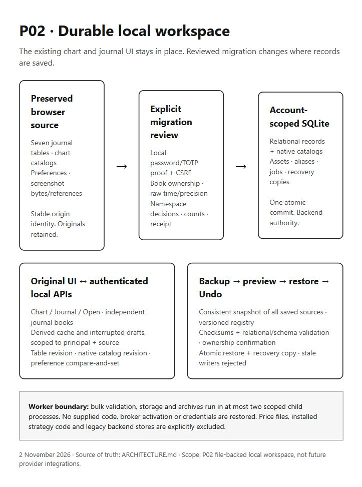

# P02 local storage architecture

2 November 2026. This repository is the documentation home for P02, as approved by the user. This describes implemented storage flows, not future market-data or execution integrations.

The original Workspace, Chart / Journal / Open actions and journal tabs remain the product UI. Before an explicit reviewed migration, the original browser databases remain authoritative. Afterwards the authenticated local SQLite store owns that account's selected source; IndexedDB holds a derived cache and interrupted drafts. The original browser records and native catalogs remain preserved for export and recovery.

## Account and data boundaries

The existing User receives a stable random `identity_uid`; a rename or reused numeric user ID cannot transfer data ownership. A verified password and required TOTP establish a revocable, hashed local session. Its HttpOnly, SameSite Strict cookie expires independently of broker rollover. Broker-only, guest and pending-factor states cannot authorize local storage. Password or factor changes and logout invalidate access. `/auth/local-session` supplies the current trusted principal to the client.

`/api/local/v1` derives ownership from this proof. Mutations retain the existing CSRF protection. Responses are private/no-store; request fields, numeric identities, relational parents, source scope and upload sizes are checked. Foreign and missing records have the same scoped not-found behavior. Portable archives never restore authentication, credentials, permissions or runtime activation.

## Implemented components

- `database/user_db.py`, `services/local_account_access.py`, `blueprints/auth.py`: existing account identities and broker-independent proof. SQLite UID migration takes a verified backup before additive DDL/backfill and supports rollback.
- `database/workspace_storage_db.py`: dedicated file-backed SQLite tables with principal/origin/numeric identities, deferred foreign keys, immutable aliases, one connected-book key per account, migration/restore jobs, idempotency receipts, attachment bytes and native catalogs. Uses the common NullPool factory, WAL/cooperative busy policy, foreign keys and FULL commit durability.
- `services/workspace_storage.py`: validates and migrates original compatibility records without pretending to recover decimal precision or unknown timezone/account identity. Canonical P01 repositories remain the normalization seam for later P03 work; they are not a second active browser writer.
- `blueprints/local_data.py`: authenticated, CSRF-protected transport. Its engine is lazily initialized and cached once per app. No installed workspace schema is created simply by importing the module.
- `services/workspace_worker.py`: at most two first-party child processes for bulk reads/saves, migration, native catalogs, preferences and archives. Fixed action allowlist; private temporary files; no shell, user code, pipes, Flask context or DB sessions crossing a thread. Polling yields under eventlet. Timeout/cancel/error paths kill and reap the child, release the slot and remove temporary files. A lost acknowledgement is retried using its durable request or job ID.
- `services/workspace_recovery.py`: versioned module registry, consistent all-origin snapshot, bounded checksummed ZIP, durable preview, ownership confirmation, atomic restore receipt and pre-restore recovery copy.
- `frontend/src/lib/trader/`: non-destructive browser capture, account/source-bound cache and drafts, explicit migration/restore API clients, native chart storage adapters and preference projection. `StorageRecovery` exposes the recovery controls in the existing Settings UI.

## Save, migrate and restore flow

The [rendered diagram source](architecture.html) presents these connections without changing the app's UI.

1. **Browser source → review:** capture all seven trader tables in a read transaction, native chart database namespaces, allowlisted preferences and portable screenshot bytes. Keep a stable origin ID and original preferences. Failed reads stop export; missing external/blob bytes become explicit unavailable references.
2. **Review → migration job:** validate on the server and persist the unchanged source, its hash, table counts, issue IDs and expected target revision. Ask for explicit raw precision/time decisions, account/manual/paper book decisions and native namespace mappings. Declared metadata never certifies a broker connection.
3. **Commit → backend authority:** compare revisions and all decisions inside one transaction. Insert parent/child rows, aliases, book bindings, assets, catalogs and receipt atomically. A repeated unchanged origin is idempotent; a changed source cannot silently overwrite an existing origin. Overlapping numeric IDs from another source remain origin-scoped.
4. **Backend → existing UI:** fetch the committed source and only then activate its derived cache. Each profile has its own manual book; connected and paper records use separate books. Every selected-book metric, trade table and calendar uses that book. Stable UID namespaces survive account rename. Chart and Journal links preserve the selected book and journal tab.
5. **Edit → saved/failed:** table saves compare table revision, native saves compare that catalog revision and preference saves compare the previous preference values. They do not share a last-writer-wins blob. A failed/conflicting/offline mutation retains the draft and retry ID. Source account facts are protected from manual economic edits. Archive keeps parent and child records; it disables an archived profile's copying flags.
6. **Snapshot → backup:** one read transaction captures every saved origin and bindings. Registry modules contain journals, notes, practice session metadata/checkpoints present in the source, native chart payloads, preferences/drafts, attachment bytes/references and dataset manifests. Credentials, runtime activation, installed strategy code, price files and unscoped legacy backend databases are named exclusions.
7. **Archive → preview → restore:** validate exact members, versions, checksums, JSON/catalog schemas, relations, size/node budgets and ownership. Keep the staged job in SQLite. Commit only with the matching confirmation and current generation. In one transaction retain a recovery copy, replace only this principal's workspace rows, rebuild ownership/bindings, advance table/native revision fences, disarm runtime flags and persist completion. Undo previews the recovery copy through the same checks.

## Limits and installation scope

The active implementation supports a file-backed local SQLite workspace. The migration snapshot format and workspace backup format are v1. Source validation caps 100,000 total trader rows per origin, 1,000 origins and 10,000 native namespaces per database; the default HTTP JSON limit is 64 MiB (configurable up to 512 MiB), attachment bytes are capped at 64 MiB each, and ZIP input is capped at 256 MiB compressed / 512 MiB uncompressed. JSON has bounded depth/nodes. Aggregate archive limits are checked on export; an oversized collection returns a structured error and keeps every stored source intact.

Tests certify disposable file-backed SQLite on this Windows/Python runtime and the supported Node frontend build. The common eventlet/gthread design is preserved and CI includes P02 tests; this work does not claim a Linux gunicorn execution that was not run locally. PostgreSQL workspace storage is rejected rather than silently treated as tested. User identity migration contains a separate PostgreSQL branch, without a PostgreSQL fixture certification here.

An offline chart can retain and export saved catalogs and navigate back to its journal. Actual price rendering still needs the original chart's configured feed/API; its honest disconnected empty state is retained. No dummy broker credentials or prices are supplied by P02. Provider sync, canonical execution reconciliation and strategy runtime deployment remain their later packages.
