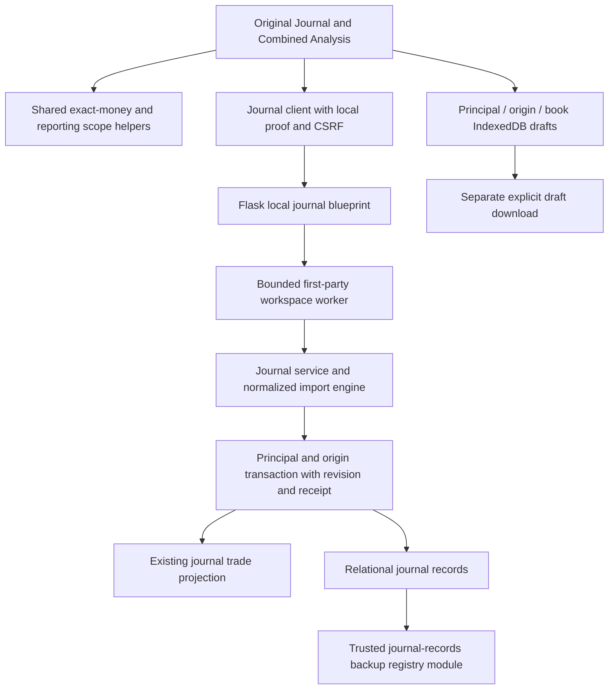

# P03 journal architecture in the original application

2 November 2026. This describes implemented source boundaries; final package acceptance is recorded separately by the P03 gate. The original Workspace, Chart and Journal screens remain the application. Profiles are environments. A connected journal book belongs to one account and may appear in linked environments; manual records have a separate book. Portfolio Overview, Connections and Settings remain behind Open.

## Request and persistence boundaries

`blueprints/journal.py` uses the P02 authenticated local proof, current server principal and CSRF boundary. A body cannot choose its owner. `services/workspace_worker.py` registers the journal actions on the existing bounded worker; it does not run arbitrary archive/request code. `services/journal_service.py` owns transactional lifecycle, review, attachment, import job and export operations. `services/journal_import.py` is the pure parser/reconciliation/projector. `services/journal_ledger.py` validates journal records during writes and recovery. Transport details are in the [local journal API](../../../api/local-journal.md).

The SQL table `workspace_journal_records` has principal UID, origin, record kind and record ID as its identity, with scoped workspace/trade/book foreign keys. Kinds are current normalized events, original source observations, user reviews, before/after history, period reviews, reusable mappings, committed batches and explicit book links. Existing journal rows remain the original UI's compatibility projection. The canonical record additions carry exact decimal strings/nulls and realization events; old numeric columns are display compatibility, not a second source of financial truth.

Mutation reads the current source in a transaction, compares `expectedRevision`, applies the action, validates the snapshot/ledger, saves both and stores its request receipt. The same stable request ID and unchanged body can recover an uncertain response. Reusing that ID with a different body or silently rebasing a stale revision is rejected. A saved notification is shown only after committed state returns. Backend disconnection never silently writes those records into a browser journal.

## Source facts, corrections and reviews

Manual capture permits an Open position without close time or realized P&L. Partial exits have their own exact quantity, net/components and offset-aware timestamp. Final close accepts the cumulative whole-position total and subtracts prior realized amounts/costs to form the last exit; it does not add the full total twice. A closed-total edit preserves earlier exits and recalculates the final residual. Correcting a recorded exit requires its ID and a reason, retains before/after history and recalculates remaining quantity/status. An open/closed transition caused by corrected quantity requires explicit confirmation. Source financial facts cannot be changed through these manual actions.

Known manual components must reconcile exactly: net = gross − commission − fees + signed swap. A genuinely unknown component remains null and does not trigger a guessed zero. Canonical commissions/fees are expense-signed (negative rebates are possible); swap is a signed credit/charge. Restore validation rejects inconsistent known totals and open/closed states that contradict known remaining quantity. Source imports preserve their declared conventions and original lexical observations; prices/multiplier fill missing economics and do not overrule reported P&L. See [calculation policy](CALCULATION_POLICY.md) and [supported statement format](SUPPORTED_STATEMENT_FORMAT.md).

Imported identity is provider + canonical account identity + external event ID. It is independent of filename, row order or environment display name. Unchanged/overlapping imports do not add another event. Changed source facts require a reviewed correction; ambiguous cross-source resemblance is not guessed into deduplication. Current normalized events/projections may change, while original source observations, history and user annotations are retained. Account copies remain financial outcomes on each account. Only declared decision/copy IDs support a separate linked-decision count; provider decision IDs are namespaced.

The projection separately records `sourceStrategy`, `sourceDecisionId` and `sourceCopyGroupId`. Source strategy labels update the active strategy only while it still follows the prior source label; a user-assigned value that differs from that tracked source survives later imports. Decision/copy annotations use the same source-following versus differing-user-override rule. Raw declared IDs remain in source events/observations, while provider-scoped decision identity prevents unrelated providers with the same short ID from becoming one decision.

Reviews have separate revision and reviewed-fact revision. Strategy/setup/tags, decision notes, optional mindset and evidence do not rewrite imported fills. A new fact revision makes an earlier reviewed state stale/unreviewed. Period reviews record book/profile, currency, strategy, reporting timezone, calendar period, included trade IDs and fact revisions/hashes. The service rejects included rows from another book, currency, strategy or local reporting period.

## Reporting and original-screen connections

`journalAnalytics.ts` provides canonical decimal observations, exact sums, source-time parsing, IANA day/week grouping and the shared scope selector. `metrics.ts` consumes the scoped parents and their trimmed realization lists. Current rolling windows end today in the displayed timezone. Every journal chart/statistic/table/export uses the displayed book, period, currency, strategy and filters; Combined Analysis additionally uses the explicitly selected profiles. A selected partial exit contributes money without completing its parent position.

Funding transfers are separate from trade P&L and exit counts. Fee-only corrections affect P&L without becoming losing trades. Distinct currencies/asset codes and quantity units remain separate. A replay starting balance is never relabelled into another currency; the filtered baseline model is distinct from full broker equity. Unknown amounts, costs, risk and time have coverage counts. Unknown chronology prevents a complete streak/drawdown claim. Generic scores/radar are removed and annualized ratios remain unavailable without a complete declared cashflow-adjusted daily return series.

Chart links preserve profile/book/trade and journal return context. Portfolio settings links return to the same journal context. They provide navigation/evidence, not a guarantee that a market feed is configured. The existing chart still reports its real missing-data/API state when no feed exists.

## Recovery and unsubmitted work

The trusted P02 registry adds `journal-records` for the saved ledger alongside the workspace tables, bindings, preferences/catalogs and permitted attachments. Backups validate references, per-kind IDs, exact projections and the active ledger mirror. Cross-owner restore rebinds local books/references while retaining raw source proof. Older P02 archives that never declared this module receive an explicit empty-ledger upgrade; a newly declared module cannot simply be removed. Restore retains the P02 preview, ownership confirmation, generation fencing, pre-restore copy and Undo path. Credentials, runtime activation, installed strategy code, market-data file contents and unscoped legacy backend databases remain excluded.

Unsubmitted forms use the separate `ChartlyJournalDrafts` IndexedDB database, keyed by principal, origin, book and form kind. Drafts retain input, retry body/identity and optional attachment bytes within their budgets. They do not automatically upload and are not contained in workspace ZIPs or committed book exports. The Journal offers explicit draft export; pending durable import jobs can resume on the same saved source and stale jobs can re-preview retained source against the current revision. Clearing browser/site storage can remove local drafts, so export them separately before that operation.

## Implemented scope and handoff

P03 covers original-screen manual lifecycle/review/history, one documented normalized CSV mapping flow, repeat/correction reconciliation, partial exits/fees/funding, scoped metrics, period reviews, evidence, drafts and additive recovery. It does not add broker/exchange connectors, an always-running history collector, live execution, FX conversion, a market-data provider, universal broker-specific CSV adapters, strategy testing or Fundamentals. P04 and later packages remain separately planned; accepting this package does not implement them.

Verification sources include [service lifecycle](../../../../test/test_journal_service.py), [independent financial review](../../../../test/test_journal_metrics_review.py), [recovery](../../../../test/test_journal_recovery.py), [metrics plan and commands](METRICS_PLAN.md), the API/client/hook tests and root-owned original-browser evidence. The [journal user guide](../../../userguide/33-trading-journal/README.md) explains the operational path.

## Verified diagrams and completion links

The [request and persistence diagram](#request-and-persistence-boundaries) describes the implemented original-app transport, transaction, ledger, recovery and separate-draft paths. The [final implementation evidence](IMPLEMENTATION_EVIDENCE.md) records automated results, resource audits and actual original-screen capture/import/review/chart-return/Undo/export journeys. Full-book export includes all rows assigned to an authorized shared book across linked environments; displayed CSV remains scoped to the active environment and filters. Historical P02 evidence is retained under the explicit [P03 compatibility/supersession contract](ACCEPTANCE_GATE.md).
