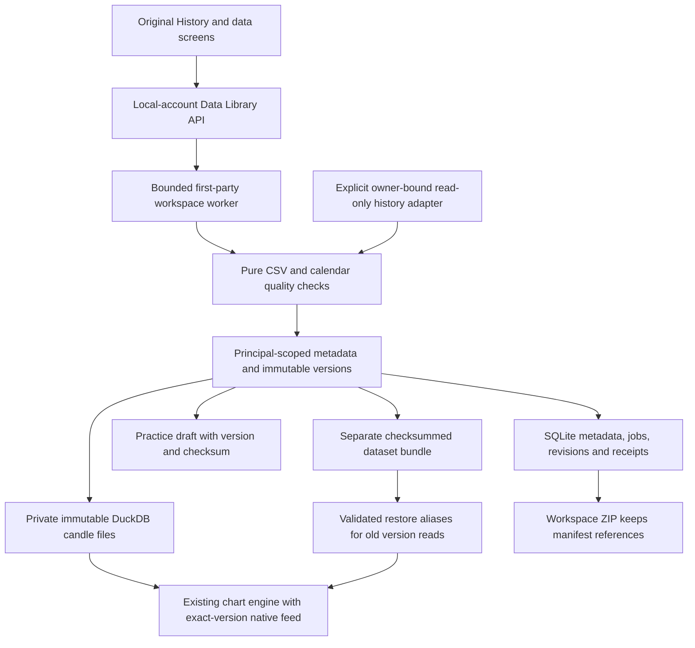

# P04 Data Library architecture

3 November 2026. This describes the implemented local history boundary. Final package acceptance, integrated counts and original-browser evidence belong to the root P04 completion record. The existing Historify/chart components remain the UI base; connected legacy provider tools remain separate.

The matching visual source is [architecture.html](architecture.html); root renders and checks [architecture.png](architecture.png) before acceptance.

## Identity and persistence

`blueprints/data_library.py` requires the verified local principal, CSRF on mutations, bounded bodies and private responses. Client JSON cannot select an owner. The `/api/local/v1/datasets` boundary uses the existing bounded workspace worker; local CSV import, catalog, detail, chart reads and export have no broker prerequisite. `services/data_library.py` owns metadata, version publication and recovery. `services/dataset_quality.py` performs pure normalization without I/O. [API contract](../../../api/local-datasets.md).

SQLite metadata lives in `data_library_states`, `data_library_datasets`, `data_library_versions` and `data_library_records`, with principal-scoped foreign keys. Logical identity includes the private source, instrument, native interval, price basis/adjustment, currency, volume meaning, negative-price permission and frozen calendar. Source/instrument IDs are resolved by trusted code rather than accepted as an owner claim. Display names do not establish economic identity.

Every canonical candle has an authoritative UTC ISO instant and exact decimal strings/nulls. Private DuckDB files store integer UTC microseconds and lexical economic values; numeric epoch seconds are chart projections. File paths derive from trusted IDs and the principal namespace. Reads verify stored file checksums and close connections; missing/changed bytes return an explicit error. New files are staged before metadata publication. Existing version files are not updated in place.

An import stages its source CSV, mapping, quality report and identified base version. `keep` retains existing candles at overlapping times; `replace` applies incoming overlaps to a new merged version; `new-version` creates an uploaded-only snapshot. None changes a prior version. Repeated identical canonical content reuses its version identity. Revisions and request receipts protect stale writes and uncertain acknowledgements. Re-preview retains the selected base, allowing an intentional branch from an older version instead of silently switching to latest.

Version `quality` and `coverage` are recomputed over the actual canonical result after the merge policy. The separate `importReport` retains the source upload's counts, quality, source hash, chosen policy and base version. A structurally clean saved result therefore does not erase a source upload's rejected-row warnings or turn its source report into a completeness claim.

Catalog pages contain at most 100 versions with an explicit `nextOffset`; retained capacity is 2000 versions and 5000 metadata records per principal. Import reviews, download/quota state and restore aliases consume the record budget. Capacity errors are explicit and never silently purge evidence.

## Quality and time

One bounded parser handles explicit ISO/seconds/milliseconds, IANA/DST validation, OHLC coherence, unknown volume/OI, ordering, duplicates and declared native intervals. Conflicting rows at one timestamp block commit; other rejected rows require explicit accepted-subset consent. No adjustment, continuous-contract roll, candle filling or resampling is inferred. Calendar snapshots describe weekly sessions and dated exceptions. Unknown calendars keep gap classification unknown; structural verification never proves source authenticity or market-data rights. See [quality policy](QUALITY_POLICY.md).

The version chart uses the existing chart/grid/pane and a feed pinned to version/checksum. It offers native bars from that version, without the legacy host-local/fixed-IST aggregation path. Each page serializes active feed I/O, coalesces identical pending windows and bounds pending consumers to 17. Settled bars are not cached globally; abort/dispose clears consumers, listeners and pending requests. Chart and library return context are retained. Preparing a practice draft passes the exact version and checksum; P06 still owns simulator readiness and execution.

## Provider download boundary

`services/dataset_provider.py` resolves principal UID to the current username and that account's own existing market-data API key. It does not select a first available credential. It checks provider binding before and after fetching, calls read-only history, formats numeric values into the declared CSV convention, requests padded dates and clips the result to the exact half-open UTC chunk. Broker-store failure makes download capability unavailable while local history stays usable.

The reused legacy history adapter can already synthesize an absent open-interest field as zero before the new bridge receives it. The bridge cannot recover that lost distinction. Omit open-interest mapping when its source meaning is unverified; fixture checks do not certify authentic OI, provider completeness or market permissions. Individual provider certification remains deferred.

`services/dataset_downloads.py` stores finite jobs, quota deadlines, attempts, retained chunks, leases and cancellation generations in scoped records. Each explicit step processes at most one chunk. Publication checks its lease/generation in the same transaction that commits the dataset and checkpoint. Paused/cancelled work cannot publish late; restart and lost replies cannot duplicate committed chunks. The new path adds no daemon or permanent scheduler. Existing legacy jobs remain outside its quota reservation. [Download plan and limits](DOWNLOAD_PLAN.md).

## Retention and backup

Archive hides a version from the default catalog while retaining bytes and exact reads. The service reports saved practice-draft references; no permanent purge is provided. There is a 2000-version bound, rather than silent deletion of older evidence.

P02 workspace ZIPs retain dataset manifests and separate-bundle links; they still exclude candle files. A dataset bundle carries canonical candles, metadata, checksums and original source CSV when available. Restore validates member names, budgets, hashes and canonical data before a reviewed commit. It rebinds private source identity to the current principal and executes no archive code. [User guide](../../../userguide/34-data-library/README.md).

### Portable saved references

Cross-owner restoration creates the destination's own version ID. Validated `versionAliases` prove each prior version ID from its dataset ID and the matching candle checksum; forged or inconsistent proofs are rejected. Detail/bar reads can resolve an old ID and disclose `resolvedFromVersionId`. Export carries valid ancestor proofs onward, so owner A → B → C recovery can retain A/B references to C's owned copy without rewriting saved practice records or journal trade facts.

A destination's native version ID always takes priority. Alias import cannot redirect that ID, and dependency reporting follows the native version rather than attributing its references to an alias target. Read resolution still verifies the content checksum and private principal. These are portable content/reference proofs, not evidence that the declared external provider is authentic. [Restore-reference regressions](../../../../test/test_data_library_restore_links.py).

## Verification boundary

Tests cover pure quality, real scoped metadata/DuckDB, authenticated local HTTP/workers, download lifecycle and owner-bound provider stubs, archive/restore and malformed bundles. Resource audits include SQLite/DuckDB closure, handles and bounded retained memory. They do not certify real provider permissions, continuous coverage, Linux deployment or arbitrary broker adapters. Root records final integrated results and original-screen journeys in [implementation evidence](IMPLEMENTATION_EVIDENCE.md).
