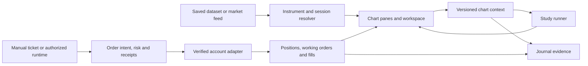

# Chartly as a trading IDE

9 November 2026. This review sets the current direction for the original app. The first release target is a chart a discretionary trader can trust throughout a session. Programming tools and additional brokers follow through the same instrument, feed and account boundaries. Fundamentals and strategy testing are outside the active release scope. The plan retains manual chart replay and the existing journal as chart workflows.

## What already exists

- **Chart workspace.** The React application uses its existing chart renderer, a chart controller per pane, a workspace repository for layouts and drawings, and a resolver for profile, journal, saved history and replay context. That is a foundation for a terminal with several panes. The first reliability problem is the handoff between the chosen feed, the pane's resolved instrument and its candle subscription. [Chart page](../../../../frontend/src/pages/Trading.tsx) · [Chart context](../../../../frontend/src/lib/trading/chartContext.ts) · [Chart controller](../../../../frontend/src/lib/trading/terminal.ts).
- **Data access.** The market API distinguishes MT5, public crypto feeds, historical FX and an OANDA reader. The service's provider inventory, the chart's live-source selector and a provider's permitted account capabilities are distinct. The Data Library already supports reviewed imports and saved versions. Its provenance and ownership are the starting point for consistent history and chart reopening. [Market feeds](../../../../services/market_feeds.py) · [Live feed adapter](../../../../frontend/src/lib/chart/feeds/platformFeed.ts) · [Saved data service](../../../../services/data_library.py).
- **Accounts.** The native MT5 adapter attaches to the already running local Windows terminal and reads the account that terminal is showing. Account snapshots and chart price data have different ownership and cadence. Current positions and orders must keep refreshing when the provider has a large deal history or the history service fails. A demo market ticket is a narrow first execution path. Its explicit review, scoped receipt and pre-send identity checks are useful integration evidence for the existing P11 execution model. [MT5 adapter](../../../../services/connector_mt5.py) · [Account dock](../../../../frontend/src/components/trading/dock/AccountFeedDock.tsx) · [Execution core](../../../../services/execution.py).
- **Programming.** The app already has custom indicator storage, a chart studies workflow and local automation. Those provide useful authoring examples and extension seams. A universal runtime still needs an explicit contract for input data, settings, outputs, execution rights and limits. [Indicator store](../../../../services/custom_indicator_store.py) · [Automation blueprint](../../../../blueprints/flow.py).

## What the research changes

TradingView documents symbol resolution, historical bars and live subscriptions as distinct methods. It keys subscriptions by dataset and delivers updates to the matching subscriber. Chartly's same-pane symbol changes need that same ownership discipline, including cancelling old work and discarding late replies. This is a useful reference for Chartly's existing renderer and adapters. [TradingView Datafeed API](https://www.tradingview.com/charting-library-docs/latest/connecting_data/Datafeed-API/) · [Datafeed subscriptions](https://www.tradingview.com/charting-library-docs/latest/connecting_data/datafeed-api/datafeed-subscriptions/).

Databento's instrument definitions model attributes such as expiry, strike and tick size as point-in-time data. Its schemas distinguish event timestamps from receive timestamps. Chartly needs similarly explicit concepts so a futures contract, continuous chart series, CFD, spot asset and perpetual cannot collapse to one text ticker. [Instrument definitions](https://databento.com/docs/schemas/instrument-definitions) · [Timestamp conventions](https://databento.com/docs/conventions/common-fields-enums-types).

MT5 exposes distinct calls for bars, positions, working orders, checks and order submission. IBKR's TWS API uses its own TCP protocol through TWS or IB Gateway. CCXT has a unified subset with exchange-specific capabilities and parameters. FIX execution reports distinguish the current order state from the purpose of the report. Together these support a common Chartly interface with provider adapters and per-account capability evidence. [MT5 bars](https://www.mql5.com/en/docs/python_metatrader5/mt5copyratesfrompos_py) · [MT5 positions](https://www.mql5.com/en/docs/python_metatrader5/mt5positionsget_py) · [MT5 order check](https://www.mql5.com/en/docs/python_metatrader5/mt5ordercheck_py) · [MT5 order send](https://www.mql5.com/en/docs/python_metatrader5/mt5ordersend_py) · [IBKR TWS API](https://www.interactivebrokers.com/docs/tws-api/doc/introduction) · [CCXT manual](https://github.com/ccxt/ccxt/wiki/Manual) · [FIX Trade specification](https://archive.fixtrading.org/online-specification/business-area-trade/).

The Language Server Protocol separates editor features from language-specific tooling. LEAN independently separates data feeds, algorithm languages and transaction handlers. For Chartly, use language servers for editing and a separate versioned process protocol for running studies or sending an order intent. A sandboxed WebAssembly runtime is an option for portable studies with explicit host functions and resource limits. Native programs and EAs need their own runtime and permission boundary. [Language Server Protocol](https://microsoft.github.io/language-server-protocol/) · [LEAN architecture](https://www.quantconnect.com/docs/v2/lean-engine/getting-started) · [Wasmtime security model](https://docs.wasmtime.dev/security.html).

## Architecture to build toward

**Instrument identity.** Use an internal instrument ID with a provider-specific binding. Store the original native symbol, venue, product type, quote and settlement currencies, price increment, size step and multiplier. Include expiry, strike, option side or funding terms when the product requires them. Keep the research or chart symbol and broker order symbol independently resolved. A continuous futures series requires an explicit current deliverable contract before offering an order. A convenient display alias never authorizes a command.

**Chart feed contract.** A feed advertises instruments, bar intervals, sessions, coverage, latency class and available quote types. A request binds the dataset ID, instrument binding, resolution, calendar and price basis. Every reply includes observed freshness and explicit errors. Keep source timestamps alongside normalized values. Preserve provider session boundaries and distinguish a scheduled break from missing data. Use an atomic pane transition from requested to ready, with a retry and the symbol picker available throughout. On reconnect, backfill the missing interval before resuming updates. Share subscriptions across panes only when all source keys match.

**Account and execution contract.** Model the data feed and trade account as independent choices. Show the active environment, account and order instrument in each ticket. Normalize commands and receipts while retaining native tickets, raw outcomes and venue constraints. Model account equity, working orders and fills separately. Use the existing execution core for durable account-bound intents, idempotency, reservations and reconciliation when the next adapter is wired for broader execution. Chart studies and replay can consume chart state without inheriting order authority. On an ambiguous native outcome, reconcile the existing command before any retry.

**Language contract.** Start with a versioned manifest and messages over a local process transport. Define a handshake, granted capabilities, instrument metadata, bar and tick events, study outputs, logs, cancellation and limits. Identify the exact dataset version and visible data cutoff for historical runs. Ship two reference clients that solve the same indicator problem, for example TypeScript and Python. A Rust, C#, Java or other client can then implement the same protocol. Introduce language-server editing separately. Keep existing trusted chart indicators usable while an isolated runtime is developed for externally supplied code.

## Build order and acceptance

1. **Stabilize one chart workflow.** In the original terminal, open an MT5 profile and load FX, a suffixed symbol and an available non-FX symbol from its catalog. Switch symbols and timeframes rapidly, reopen the layout, and exercise two independent panes. Cover insufficient native history, closed sessions, stale quotes and a stopped terminal. Keep the picker usable in every state. Verify the same saved version still opens from the journal and from manual replay. Benchmark first load and symbol switch on the current setup before assigning performance targets.
2. **Finish the terminal read workflow.** Compare Chartly positions, pending orders and recent deals to the running MT5 Toolbox on a demo account. Check lots, direction, ticket and P&L against native rows. Verify that a chart symbol switch preserves the correct account, an account switch clears prior rows, and history failure leaves current positions visible. Confirm provider time across session and DST boundaries before normalizing fills into a journal.
3. **Certify one command path.** Use a real demo session to exercise review, broker permission denial, a deliberate demo fill, partial or rejected outcomes, reconnect and reconciliation. Record the broker's evidence beside Chartly's receipt. Wire the native path into the common P11 execution lifecycle before offering more order types, attached protection or real-account execution. A separate positive certification is required for each of those capabilities.
4. **Publish the data adapter contract.** Make MT5 and a public crypto feed pass the same catalog, candles, precision, subscription lifecycle and reconnect suite. Add a third different source through the public contract to prove it works without provider-specific edits in the chart page. Validate entitlement and permitted storage for every source.
5. **Publish the broker adapter contract.** Reuse scoped local access, the connector vault and canonical execution records. Certify one additional broker in its allowed demo environment. Cover cash, leveraged FX or CFD, futures, options and crypto with product-specific quantity, margin and lifecycle rules as each adapter is added. Display capabilities from verified account access and measured behavior.
6. **Open the programming surface.** Provide chart-bound study inputs and output inspection first. Ship the two reference clients, logs and bounded runtime. Add external editor and language-server integration when the protocol is stable. Evaluate automated execution only after the manual account, command and recovery workflow has passed.

Native verification has now confirmed candle and history reads from the running MT5 terminal. The account had no open positions or working orders, so row-level comparison with a populated account, provider clock behavior across DST, and a native demo execution receipt remain open. A closed session can prevent UTC alignment when MT5 supplies no recent reference quote, even if the terminal has cached candles. Keep the chart's explicit time-alignment error until a reliable historical clock mapping or labeled broker-clock display is available.

The current ticket uses MT5's Python terminal API. Its market order check and receipt flow have controlled SDK coverage. Submission is disabled by default and can be enabled for an isolated demo certification session with `CHARTLY_MT5_DEMO_ORDERS=true` in the app server environment. The server verifies the local operator, exact terminal account, lot grid and current quote, then saves the attempt before calling the terminal. The browser retains the random receipt ID across a reload, and a protected read-only status check retrieves the saved result. A genuinely unknown terminal response still requires comparison against MT5 by order comment. The native order request addresses the current terminal session, so the demo certification should use a dedicated terminal session. The preflight price check covers quote drift before dispatch. The broker determines the fill price under its market execution rules.

## Verification on 9 November

- The production frontend build, type check and scoped lint passed. The full frontend suite passed 3,617 tests across 319 files. The focused backend suite passed 248 tests, including receipt recovery and access control, chart context, local storage, journal and replay. The repository-wide backend run encountered seven collection errors in tests for absent legacy broker and specialist modules. Continuing past collection hit a proxy timeout in the Windows sandbox.
- The running app opened the original MT5 chart from Workspace and kept symbol search and retry available when the terminal was offline. With MT5 open, the chart rendered EURUSD and GBPUSD on 15 minutes, switched GBPUSD to one hour, and loaded native deal history in the dock. The terminal adapter also returned 15-minute and hourly candles for XAUUSD and AAPL. Open positions and working orders matched the terminal's empty lists. No order was submitted.
- A browser fixture rendered saved candles from the original chart and from the profile journal, verified the return link to the same journal, and opened the saved replay run with manual replay controls. The Workspace navigation retained Workspace and Automation and omitted the retired Fundamentals and strategy workflows.
- Public data probes returned hourly candles for Kraken ETH/USD and Hyperliquid kBONK. These probes verify data access for those bindings.
